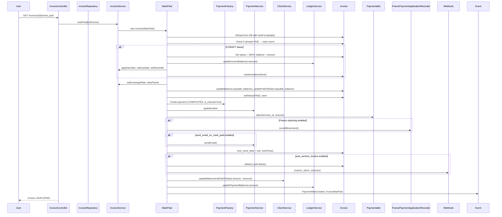
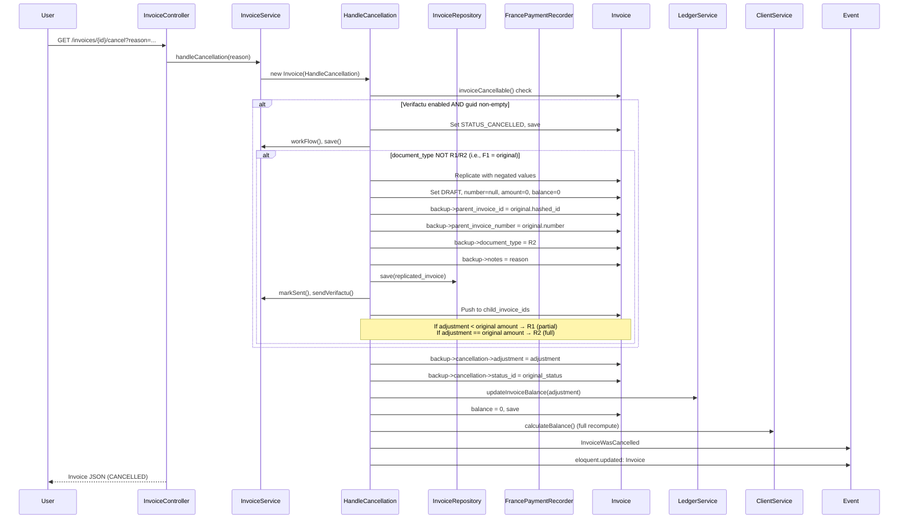

# InvoiceNinja v5.13.50 — Invoice Management Module FRD

> **Source base:** `E:\invoiceninja-5.13.50`
> **Sources:** `app/Models/Invoice.php`, `app/Services/Invoice/InvoiceService.php`, `app/Services/Invoice/MarkSent.php`, `app/Services/Invoice/MarkPaid.php`, `app/Services/Invoice/ApplyPayment.php`, `app/Services/Invoice/HandleCancellation.php`, `app/Services/Invoice/HandleRestore.php`, `app/Services/Invoice/TriggeredActions.php`, `app/Http/Controllers/InvoiceController.php`, `app/Http/Requests/Invoice/StoreInvoiceRequest.php`, `app/Http/Requests/Invoice/ActionInvoiceRequest.php`, `app/Helpers/Invoice/InvoiceSum.php`, `app/Helpers/Invoice/Discounter.php`, `app/Helpers/Invoice/Taxer.php`, `routes/api.php`

---

## 1. System Overview & Boundaries

### Scope
**In-scope:**
- Creation, retrieval, update, deletion of invoices
- Invoice lifecycle: Draft → Sent → Paid/Partial/Cancelled
- Invoice-to-payment application (full and partial)
- Invoice calculations: line items, discounts, taxes, surcharges, balances
- Number generation, due date calculation, reminders
- PDF generation and email delivery to clients
- E-invoice generation (Verifactu/Spain, Peppol)
- Inventory adjustments on invoice creation/void/restore
- Proforma invoices
- Archive (soft-delete) on payment with `auto_archive_invoice` setting
- Cancellation and restoration with ledger corrections

**Out-of-scope:**
- Recurring invoice generation (see `04_Recurring_Engine_FRD.md`)
- Payment gateway processing (see `02_Payment_Management_FRD.md`)
- Credit note issuance (see `03_Quote_Management_FRD.md` — Credits section)
- External integrations (QuickBooks, Stripe — see `12_Integrations_FRD.md`)

### Actors
| Actor | Role |
|---|---|
| **Authenticated User** | System user (admin, manager, or standard) — can create/edit/send/invoice |
| **Client (Portal User)** | External customer — views, downloads, pays via portal; no direct API access |
| **Payment Gateway** | External system sending webhook callbacks — updates invoice/payment status |
| **Cron/System** | Background jobs for reminders, auto-archive, inventory, e-invoice submission |
| **QuickBooks Integration** | External sync service — receives invoice data for accounting sync |

### Triggers
| Trigger | Type | Source |
|---|---|---|
| `POST /api/v1/invoices` | User action | Authenticated user via API/UI |
| `PUT /api/v1/invoices/{id}` | User action | Authenticated user editing draft invoice |
| `GET /api/v1/invoices/{id}/{action}` | User action | mark_sent, mark_paid, cancel, restore |
| Payment application via gateway webhook | System | Payment gateway HTTP callback |
| Recurring invoice generation | Scheduled | Cron job (`SendRecurring`) |
| Reminder scheduled date reached | Scheduled | Cron job |

---

## 2. Functional Input/Output Matrix

| Trigger / Action | Input Data | Validation Rules | Expected Output / Side Effects |
|---|---|---|---|
| **Store Invoice** (`POST /api/v1/invoices`) | `client_id`, `line_items[]`, `date`, `terms`, `footer`, `discount`, `is_amount_discount`, `tax_name1-3`, `tax_rate1-3`, `po_number`, `custom_value1-4`, `partial`, `partial_due_date`, `exchange_rate`, `assigned_user_id`, `project_id`, `location_id`, `design_id`, `is_proforma` | Client must be valid and accessible; user must have create permission; currency must match client setting or company default | Invoice created in DRAFT state; calculated `amount`, `balance`, `total_taxes` via InvoiceSum; balance = amount for DRAFT; `next_send_date` = null |
| **Update Invoice** (`PUT /api/v1/invoices/{invoice}`) | Same as store, plus `number` override | Must be DRAFT or SENT status; user has edit permission; entity not deleted | Invoice fields updated; `amount`/`balance` recalculated; if SENT, balance adjusted for delta |
| **Mark Sent** (`GET /api/v1/invoices/{invoice}/mark_sent`) | Optional: `mark_sent=true`, `send_email=true` | Must be DRAFT; company not on free tier for email sending | Status → SENT; `balance` = `amount`; `due_date` auto-calculated from `payment_terms`; `next_send_date` set per reminder schedule; `number` applied; `markInvitationsSent()` called; ledger entry created; client balance increased by `amount` |
| **Mark Paid** (`GET /api/v1/invoices/{invoice}/mark_paid`) | Optional: `reference` string, `paid=true` | Must be DRAFT or SENT; no existing payment with same reference (idempotency) | If DRAFT → auto-marks SENT first; creates a manual `Payment` (status COMPLETED); invoice balance → 0; status → PAID; client `balance` and `paid_to_date` updated; ledger entries created; `PaymentWasCreated` + `InvoiceWasPaid` events fired; if `auto_archive_invoice` → soft-deletes invoice |
| **Apply Payment Amount** (`POST action: amount_paid`) | `amount_paid` (float), optional `reference` | Amount must be numeric and positive; invoice must be sent/paid/partial | Payment applied to invoice; if remaining balance = 0 → status PAID; if partial → status PARTIAL; client balance and paid_to_date updated |
| **Apply Payment (from Payment entity)** | `Payment` object, `amount` float | Payment must be COMPLETED status; invoice must be in SENT/PARTIAL state | `updateBalance(-amount)` on invoice; `updatePaidToDate(amount)`; status recalculated; `next_send_date` cleared if balance = 0; client balance adjusted |
| **Cancel Invoice** (`GET /api/v1/invoices/{invoice}/cancel`) | Optional: `reason` | Must be cancellable (not PAID with applied payments; not already cancelled; not proforma) | Status → CANCELLED; balance → 0; ledger entry with adjustment; if Verifactu enabled → creates R1/R2 rectification document; `next_send_date` = null |
| **Restore Invoice** (`GET /api/v1/invoices/{invoice}/restore`) | None | Invoice must be soft-deleted; no active payment dependencies (or payments restored too) | Soft-delete reversed; balance recalculated from `amount`; invoice number wound back or reassigned; paymentables restored; client balance recalculated; inventory adjusted |
| **Send Email** (`GET action: send_email`) | Optional: `contact_id` | Must have at least one invitation with valid email; SMTP/mailer configured | Email dispatched to client contact(s); `last_sent_date` updated; if Verifactu enabled → `SendToAeat` job; if Peppol enabled → `SendEDocument` job; webhook `EVENT_SENT_INVOICE` fired |
| **Auto-bill** (`auto_bill` trigger) | From recurring invoice or subscription | `auto_bill_enabled = true`; valid payment method on file | `AutoBillInvoice` job dispatched; payment processed via gateway; invoice marked paid if successful |
| **Add Payment Schedule** (`POST payment_schedule`) | Array of schedules with `amount` and `date` | Amounts must sum to invoice total; dates must be valid | Payment schedule stored; used for staged payment reminders |
| **Update Reminders** (`POST update_reminders`) | Reminder data (dates, templates) | Invoice must be SENT status | Reminder schedule recalculated; `reminder1_sent` etc. reset if needed |

---

## 3. State Transition Matrix

> **Sources:** `app/Models/Invoice.php` (§Invoice Status Constants), `app/Services/Invoice/MarkSent.php` (lines 26-33), `app/Services/Invoice/MarkPaid.php` (lines 38-98), `app/Services/Invoice/HandleCancellation.php` (lines 31-62), `app/Services/Invoice/HandleRestore.php` (lines 36-78), `app/Services/Invoice/InvoiceService.php` (`setCalculatedStatus()`, `updateStatus()`, `workFlow()`)

| Current State | Event / Trigger | Condition | New State | Actions Triggered |
|---|---|---|---|---|
| DRAFT | Mark Sent | User has permission; invoice not deleted | SENT | Apply number; calculate due date from `payment_terms`; set reminder schedule; mark invitations sent; create ledger entry (`updateInvoiceBalance(+amount)`); update client balance (+amount); fire `InvoiceWasUpdated` event; if quickbooks sync enabled, collect for sync |
| DRAFT | Mark Paid | Not previously paid | SENT → PAID | Calls `markSent()` first (transitions to SENT if DRAFT); creates `PaymentFactory` with `STATUS_COMPLETED`; sets payment amount = invoice balance; attaches paymentable; updates invoice balance to 0; updates client balance and paid_to_date; fires `PaymentWasCreated` + `InvoiceWasPaid` events; if `send_email_on_mark_paid` → sends payment email; if `auto_archive_invoice` → calls `workFlow()` which soft-deletes the invoice |
| DRAFT | Cancel | Must be cancellable | CANCELLED | (Rare for DRAFT; usually must be sent first) |
| DRAFT | Delete (soft) | User has permission | DELETED (soft) | Sets `is_deleted = true`; fires `InvoiceWasDeleted` event; if Verifactu enabled and has GUID → `SendToAeat` cancel job dispatched |
| SENT | Apply Payment (partial) | Payment amount < balance | PARTIAL | `updateBalance(-payment_amount)`; `updatePaidToDate(+payment_amount)`; if `auto_archive_invoice` disabled; `checkReminderStatus()` only if `had_partial`; client balance adjusted |
| SENT | Apply Payment (full) | Payment amount ≥ balance | PAID | `updateBalance(-payment_amount)` to 0; `updatePaidToDate(+payment_amount)`; `clearPartial()` if was partial; `unlockDocuments()` if `unlock_invoice_documents_after_payment`; if `auto_archive_invoice` → soft-delete via `workFlow()` |
| SENT | Apply Payment (overpay) | Payment amount > balance | PAID | Payment amount capped at invoice balance; excess stays as unapplied payment on client |
| SENT | Cancel | Must be cancellable | CANCELLED | If Verifactu enabled and document_type ≠ R1/R2 → creates R1 or R2 rectification invoice (replicates invoice with negated line items and amounts); sets `balance = 0`; ledger entry with negative adjustment; client balance recalculated via `calculateBalance()`; fires `InvoiceWasCancelled` event |
| SENT | Restore | Must be soft-deleted | DRAFT or original status | Reverses `is_deleted`; restores paymentables; recalculates `balance` from `amount`; client balance and paid_to_date updated; invoice number wound back; if Verifactu enabled → writes tax event corrections |
| SENT | Update (edit) | Entity not archived; user has permission | SENT (updated fields) | Recalculates invoice totals; adjusts balance for deltas; creates new backup version in history |
| SENT | Delete (soft) | User has permission | DELETED (soft) | Sets `is_deleted = true`; if Verifactu → `SendToAeat` cancel job; fires `InvoiceWasDeleted` event |
| PARTIAL | Apply Payment (full) | Payment covers remaining balance | PAID | `updateBalance(-remaining)` to 0; `clearPartial()`; `setDueDate()`; status → PAID; same post-actions as above |
| PARTIAL | Apply Payment (partial) | Payment less than remaining | PARTIAL | Balance reduced; status remains PARTIAL |
| PARTIAL | Cancel | Must be cancellable | CANCELLED | Same as SENT cancellation |
| PAID | Auto-archive | `auto_archive_invoice` = true and client setting | DELETED (soft) | `workFlow()` calls `$this->invoice->delete()`; fires `InvoiceWasArchived` event |
| PAID | Mark Sent | (edge case) | N/A | `MarkSent` checks `where('status_id', STATUS_DRAFT)` — if not DRAFT, update affects 0 rows, returns immediately (race condition guard) |
| PAID | Cancel | Must be cancellable (rare — only if no hard constraints) | CANCELLED | Same cancellation logic applies |
| PAID | Restore | Must be soft-deleted | PAID (or DRAFT if number conflicts) | Full restoration with paymentable recovery |
| CANCELLED | Restore | Must be soft-deleted | Original status (before cancellation) | Reverses cancellation; restores balance from backup; creates ledger correction |
| CANCELLED | Auto-archive | `auto_archive_invoice_cancelled` = true | DELETED (soft) | `workFlow()` calls `delete()`; fires `InvoiceWasArchived` event |
| * | Payment date change | Payment applied to invoice; date modified | (no state change) | If France reporting enabled → `FrancePaymentApplicationRecorder::recordApplicationDateChange()` logs the date mutation with UUID identity |

### 3.1 State Transition Guards & Business Rules

1. **Race condition prevention (MarkSent):** Uses atomic `UPDATE ... WHERE status_id = DRAFT AND is_deleted = false SET status_id = SENT`. If 0 rows affected (another process already claimed it), returns immediately.
   - **Source:** `app/Services/Invoice/MarkSent.php`, lines 28-38

2. **Double-payment prevention (MarkPaid):** Checks `if ($this->invoice->status_id == Invoice::STATUS_PAID)` at entry — if already PAID, returns without action.
   - **Source:** `app/Services/Invoice/MarkPaid.php`, lines 38-41

3. **Cancellation guard:** `invoiceCancellable()` method enforces:
   - Invoice is not a proforma (`is_proforma`)
   - Invoice has not been deleted
   - Invoice is not already cancelled
   - If Verifactu enabled, document type must not already be R1/R2
   - **Source:** `app/Models/Invoice.php` (method `invoiceCancellable`)

4. **Balance-to-zero check:** Uses `round($balance, 2) == 0` throughout (not exact float comparison) to handle floating-point precision.
   - **Source:** `app/Services/Invoice/InvoiceService.php`, lines 149, 344, 361

5. **Proforma exception:** Proforma invoices (status `STATUS_UNPAID=6`) do not affect client balance calculations.
   - **Source:** `app/Models/Invoice.php` (status constants), `app/Services/Client/ClientService.php` line 79 (`where('is_proforma', false)`)

6. **Auto-archive:** Only triggers after `workFlow()` is called, which checks `client->getSetting('auto_archive_invoice')`.
   - **Source:** `app/Services/Invoice/InvoiceService.php`, lines 657-668

7. **Invoice restoration constraint:** Cannot restore if the invoice has a deleted payment when `paid_to_date == 0`.
   - **Source:** `app/Services/Invoice/HandleRestore.php`, lines 45-50

---

## 4. Business Logic & Rule Extraction

### 4.1 Invoice Calculation Pipeline

> **Source:** `app/Helpers/Invoice/InvoiceSum.php` (method `build()`, lines 79-91)

The invoice total is computed through a deterministic pipeline:

```
1. calculateLineItems() → InvoiceItemSum::process()
   │  └─ Per-line: quantity × unit_cost, with line-level discount and tax
   └─ Produces: sub_total (net), gross_sub_total (net + taxes)
   ↓
2. calculateDiscount() → Discounter::discount()
   │  └─ Invoice-level discount (amount or percentage)
   └─ Subtract from total (post line-item but pre-tax adjustment)
   ↓
3. calculateInvoiceTaxes() → Taxer::taxer()
   │  ├─ If client is_tax_exempt → all taxes = 0
   │  ├─ For each tax_name1/2/3 (if strlen ≥ 2):
   │  │   └─ tax = taxer(total, rate) + surcharge_tax_totals
   │  └─ tax_map built per-tax-name with base_amount
   └─ total_taxes accumulated
   ↓
4. calculateCustomValues() → CustomValuer
   │  └─ custom_surcharge1-4 added to total
   └─ total += total_custom_values
   ↓
5. calculateTotals() → total += total_taxes
   ↓
6. calculateBalance() → setCalculatedAttributes()
   │  ├─ If STATUS_CANCELLED → balance = 0
   │  ├─ If not DRAFT → balance adjusted by amount_delta (new_total - old_amount)
   │  ├─ amount = roundValue(total, precision)
   │  ├─ if rappen_rounding → round to nearest 0.05
   │  └─ balance updated
   └─ final balance set
```

**Key precision note:** All monetary values are rounded using `Number::roundValue($value, $precision)` where `$precision` comes from the client's currency (`client->currency()->precision`). Most currencies use 2 decimal places.

### 4.2 Discount Logic

> **Source:** `app/Helpers/Invoice/Discounter.php` (846 chars total)

```
discount($sub_total)
├─ If invoice has no discount set → return 0
├─ if is_amount_discount = true → return discount (fixed amount)
├─ if is_amount_discount = false → return sub_total × (discount / 100) (percentage)
└─ Result is subtracted from the subtotal to produce the discounted total
```

### 4.3 Tax Logic

> **Source:** `app/Helpers/Invoice/Taxer.php` (1,571 chars)

```
taxer($net_amount, $tax_rate)
├─ If client is_tax_exempt → return 0
├─ Calculate: round($net_amount × ($tax_rate / 100), precision)
└─ Return tax amount
```

Invoice-level taxes (tax_name1/2/3) are applied to the **post-discount total** (after line-item processing and discount, before custom surcharges). Surcharges (custom_surcharge1-4) have their own tax flags (`custom_surcharge_tax1-4`).

### 4.4 Due Date Calculation

> **Source:** `app/Services/Invoice/InvoiceService.php`, `setDueDate()` method (lines 284-298)

```
If due_date is already set → skip (no recalculation)
If client.payment_terms is empty → no due date set
If invoice has partial > 0 and no partial_due_date:
   partial_due_date = date + payment_terms days
Else:
   due_date = date + payment_terms days
```

**Key rule:** The due date is calculated from the invoice date plus the client's `payment_terms` setting (in days). If `payment_terms` is empty/null, no due date is set.

### 4.5 Partial Payment Logic

> **Source:** `app/Services/Invoice/ApplyPayment.php` (full logic), `app/Services/Invoice/MarkPaid.php`

Three partial payment scenarios are handled:

**Scenario A — Underpaying a deposit (partial > 0):**
If the invoice has a partial set AND the payment amount < partial amount:
- `updatePartial(payment_amount)` — increases `partial` field by payment_amount (stored as negative)
- `updateBalance(payment_amount × -1)` — reduces balance
- `updatePaidToDate(payment_amount × -1)` — increases paid_to_date
- Status remains PARTIAL

**Scenario B — Covering exact balance:**
If payment_amount == invoice.balance:
- Status → PAID
- Balance → 0

**Scenario C — Underpaying balance (no partial set):**
If payment_amount < invoice.balance (and no partial or partial already covered):
- Status → PARTIAL
- Balance reduced by payment_amount

**Scenario D — Overpaying:**
If payment_amount > invoice.balance:
- Payment amount capped at balance
- Excess becomes unapplied payment on client
- Status → PAID

### 4.6 Invoice Number Generation

> **Source:** `app/Services/Invoice/ApplyNumber.php`

```
applyNumber()
├─ Uses company settings: invoice_number_prefix, invoice_number_suffix, counter_number, padding
├─ Increments company counter
├─ Formats: {prefix}{padded_counter}{suffix}
└─ Sets invoice.number
```

- Numbers are generated when the invoice is first marked sent or when `counter_number_applied = 'when_saved'`.
- The counter is company-scoped and sequential.

### 4.7 Reminder Schedule

> **Source:** `app/Services/Invoice/UpdateReminder.php` (via `setReminder()`), `app/Services/Invoice/InvoiceService.php` (`checkReminderStatus()`, `touchReminder()`)

Reminders are configured via `reminder1/day`, `reminder2/day`, `reminder3/day` settings (days before due date). The system:

1. On markSent: calculates reminder dates based on due date and client settings
2. Sets `next_send_date` to the first reminder date
3. When `next_send_date` is reached (cron job), sends the reminder email
4. After sending reminder1, `next_send_date` advances to reminder2 date (if configured)
5. After 3 reminders, transitions to "endless_reminder" mode (if enabled) or stops

**Reminder templates:** `reminder1`, `reminder2`, `reminder3`, `endless_reminder`

---

## 5. Step-by-Step Functional Workflows

### 5.1 Create and Send Invoice (Happy Path)

1. **Pre-conditions:**
   - Authenticated user with `create` permission on Invoice
   - Valid `client_id` belonging to the same company
   - Line items with valid `product_key`, `cost` (≥0), `quantity` (≥0)
   - Optional: tax names/rates, discount, terms, footer

2. **Execution Steps:**
   - Step 1: `POST /api/v1/invoices` → `InvoiceController::store()` validates via `StoreInvoiceRequest`
   - Step 2: Invoice persisted in DRAFT state via `InvoiceRepository::save()`
   - Step 3: `InvoiceService::fillDefaults()` applies company settings defaults for terms, footer, public_notes, exchange_rate, design_id
   - Step 4: `InvoiceSum::build()` calculates `amount`, `total_taxes`, `balance` (= amount for DRAFT)
   - Step 5: If `counter_number_applied == 'when_saved'`, `applyNumber()` generates invoice number
   - Step 6: `adjustInventory()` called if `company->track_inventory` is true
   - Step 7: To send: `GET /api/v1/invoices/{id}/mark_sent?send_email=true`
   - Step 8: `MarkSent::run()` atomically updates DRAFT → SENT using raw SQL UPDATE with `where('status_id', STATUS_DRAFT)` guard (prevents race conditions)
   - Step 9: `due_date` auto-calculated from `client->payment_terms`
   - Step 10: `applyNumber()` called if number not yet set
   - Step 11: `setReminder()` schedules first reminder based on reminder settings
   - Step 12: `markInvitationsSent()` records invitation send timestamps
   - Step 13: Ledger entry: `updateInvoiceBalance(+amount, "marked as sent")`
   - Step 14: Client balance updated: `client->updateBalance(+amount)`
   - Step 15: `InvoiceWasUpdated` event fired
   - Step 16: If `send_email=true`: email dispatched to all client contacts with valid invitations
   - Step 17: If QuickBooks sync enabled: invoice collected for sync
   - Step 18: If Verifactu enabled: `SendToAeat` job dispatched for AEAT submission

3. **Post-conditions:**
   - Invoice status = SENT
   - Invoice has a number
   - Invoice has calculated `due_date`
   - Client balance increased by invoice amount
   - First reminder scheduled
   - Email sent to client (if requested)

### 5.2 Mark Invoice as Paid — Full Payment (Happy Path)

1. **Pre-conditions:**
   - Invoice is SENT (or DRAFT)
   - Invoice is not already PAID
   - No conflicting payment reference (if reference provided)

2. **Execution Steps:**
   - Step 1: `GET /api/v1/invoices/{id}/mark_paid?reference=Check-12345`
   - Step 2: `MarkPaid::run()` begins a DB transaction
   - Step 3: Checks if already PAID → returns early if so
   - Step 4: If DRAFT: transitions to SENT — sets balance = amount, creates ledger entry, applies number, sets due date, sets reminder, marks invitations sent
   - Step 5: Sets `payable_balance = invoice.balance`
   - Step 6: Updates invoice: `setExchangeRate()`, `clearPartial()`, `updateBalance(-payable_balance)`, `updatePaidToDate(payable_balance)`, `setStatus(PAID)`, `unlockDocuments()`, saves
   - Step 7: Creates `PaymentFactory` with: amount=balance, status=COMPLETED, client_id, type_id from client settings, exchange rate, currency
   - Step 8: Payment number generated via `applyNumber()`
   - Step 9: Payment invoiced via `paymentables` pivot: `attach(invoice_id, amount=balance)`
   - Step 10: If France reporting enabled → `FrancePaymentApplicationRecorder::recordMovement()` logs the payment application
   - Step 11: If `send_email_on_mark_paid` → payment email sent
   - Step 12: Invoice `next_send_date` = null
   - Step 13: Ledger: `updatePaymentBalance(-payable_balance, "Marked Paid Activity")`
   - Step 14: Client: `updateBalanceAndPaidToDate(-payment_amount, +payment_amount)`
   - Step 15: `workFlow()` called:
     - If `auto_archive_invoice` enabled → `invoice->delete()` (soft-delete) + `InvoiceWasArchived` event
   - Step 16: Events fired: `PaymentWasCreated`, `InvoiceWasPaid`, `eloquent.updated: Invoice`
   - Step 17: Client balance recalculated if DRAFT→SENT transition occurred

3. **Post-conditions:**
   - Invoice status = PAID (and possibly soft-deleted if auto-archive)
   - Payment record created with status COMPLETED
   - Paymentable linking payment to invoice
   - Client balance and paid_to_date updated
   - Ledger entries created for both invoice and payment

### 5.3 Apply Partial Payment to Invoice

1. **Pre-conditions:**
   - Invoice is SENT or PARTIAL
   - Payment has been created (or is being created in the same transaction)

2. **Execution Steps:**
   - Step 1: Payment is stored via `PaymentRepository::save()`
   - Step 2: For each invoice in `data['invoices']`:
     - Create `Paymentable` pivot record with `amount`
     - Call `Invoice::service()->markSent()->applyPayment(payment, amount)->save()`
   - Step 3: `ApplyPayment::run()`:
     - If invoice had partial AND payment < partial: updates partial field
     - If payment == balance: status → PAID
     - If payment < balance: status → PARTIAL
     - If payment > balance: amount capped at balance, excess stays unapplied
   - Step 4: `updateBalance(-applied_amount)` on invoice
   - Step 5: `updatePaidToDate(+applied_amount)` on invoice
   - Step 6: `updateBalance(-applied_amount)` on client (if via gateway) or `updateBalanceAndPaidToDate()`
   - Step 7: `checkReminderStatus()` called if invoice had partial set
   - Step 8: `workFlow()` called (may trigger auto-archive if paid)
   - Step 9: `updatePaidToDate(+invoice_totals)` called on client
   - Step 10: `PaymentWasCreated` event fired (for new payments)

3. **Post-conditions:**
   - Invoice balance reduced; status PARTIAL or PAID
   - Payment record linked via Paymentable
   - Client balances updated

### 5.4 Cancel Invoice — Standard (Non-Verifactu)

1. **Pre-conditions:**
   - Invoice status is SENT or PARTIAL
   - `invoiceCancellable()` returns true
   - No Verifactu constraints or Verifactu not enabled

2. **Execution Steps:**
   - Step 1: `HandleCancellation::run()` called
   - Step 2: `invoiceCancellable()` check — rejects proforma, deleted, already cancelled
   - Step 3: If Verifactu enabled → delegates to `verifactuCancellation()` (see §5.5)
   - Step 4: Calculate adjustment = invoice.balance (or abs(balance) if negative)
   - Step 5: `backupCancellation(adjustment)` — stores adjustment and original status in backup
   - Step 6: Ledger entry: `updateInvoiceBalance(adjustment, "Invoice {number} cancellation")`
   - Step 7: Set `invoice.balance = 0`, `invoice.status_id = STATUS_CANCELLED`, save
   - Step 8: `client->calculateBalance()` — recomputes client balance from all invoices
   - Step 9: `workFlow()->save()` — if `auto_archive_invoice_cancelled` → soft-delete
   - Step 10: `InvoiceWasCancelled` event fired
   - Step 11: `eloquent.updated: Invoice` event fired

3. **Post-conditions:**
   - Invoice status = CANCELLED
   - Invoice balance = 0
   - Client balance recalculated
   - Ledger entry recorded

### 5.5 Cancel Invoice — Verifactu (Spain AEAT Compliant)

1. **Pre-conditions:**
   - Invoice has Verifactu enabled (`company->verifactuEnabled()`)
   - Invoice `backup->guid` is non-empty (has been registered with AEAT)

2. **Execution Steps:**
   - Step 1: Invoice status set to CANCELLED, saved
   - Step 2: `workFlow()` called (auto-archive if configured)
   - Step 3: If document_type is R1 or R2 → already a rectification, no new document created
   - Step 4: Otherwise (F1 type = original invoice):
     - Replicate the invoice with negated values
     - Set `custom_surcharge1-4` → × -1
     - Set line items `quantity` → × -1
     - Set `status_id = DRAFT`, `date = today`, `number = null`, `amount/balance/paid_to_date = 0`
     - Set `backup->parent_invoice_id/number` to link to original
     - Set `backup->document_type = 'R2'` (full cancellation)
     - Set `backup->notes` = cancellation reason
     - Save via `InvoiceRepository::save()`
     - Call `markSent()` + `sendVerifactu()` to submit rectification to AEAT
     - Push replicated invoice hash to original's `child_invoice_ids`
   - Step 5: `InvoiceWasCancelled` event fired

3. **Post-conditions:**
   - Original invoice: CANCELLED, balance 0
   - New R2 rectification invoice created and submitted to AEAT
   - Parent-child relationship established in backup metadata

### 5.6 Restore Cancelled/Deleted Invoice

1. **Pre-conditions:**
   - Invoice is soft-deleted
   - No conflicting active payments (if `paid_to_date == 0`, cannot restore payments that are deleted)

2. **Execution Steps:**
   - Step 1: `HandleRestore::run()` called
   - Step 2: `invoice->restore()` — Laravel SoftDeletes restore
   - Step 3: If already not deleted → return immediately
   - Step 4: Check payments: if `paid_to_date == 0` and any payment is deleted → re-delete and return
   - Step 5: Ledger entry: `updateInvoiceBalance(+balance, "Restored invoice {number}")`
   - Step 6: Client: `updateBalanceAndPaidToDate(+balance, +paid_to_date)`
   - Step 7: `windBackInvoiceNumber()` — strips `_deleted` suffix from number; if conflict, assigns new number
   - Step 8: Set `is_deleted = false`, save
   - Step 9: `restorePaymentables()` — un-soft-deletes all paymentables linked to invoice's payments
   - Step 10: `setAdjustmentAmount()` — calculates total amounts from paymentables
   - Step 11: `adjustPayments()` — adjusts payment amounts based on restored paymentables
   - Step 12: `writeTaxEventCorrections()` — if Verifactu enabled, writes correction entries for restored payment applications
   - Step 13: If `track_inventory` → `AdjustProductInventory::handleRestoredInvoice()`

3. **Post-conditions:**
   - Invoice restored to active state
   - Balance and paid_to_date recalculated
   - Payments restored (amounts adjusted)
   - Tax event corrections logged (if applicable)
   - Inventory adjusted (if applicable)

---

## 6. Edge Cases & Error Behaviors

| Case ID | Description | Expected Handling |
|---|---|---|
| **EC-001** | Invoice is already PAID when markPaid is called | `MarkPaid::run()` checks `status_id == STATUS_PAID` at entry (line 39) and returns the invoice unchanged — no payment created, no error thrown |
| **EC-002** | Invoice is already PAID when markSent is called | `MarkSent::run()` uses atomic `UPDATE WHERE status_id = DRAFT`; if invoice is PAID (not DRAFT), 0 rows affected → returns immediately (line 36-38). No state change, no error |
| **EC-003** | Payment amount exceeds invoice balance (overpayment) | `ApplyPayment::run()` caps the amount at `invoice.balance` (line 58: `$amount_paid = $this->invoice->balance * -1`); excess becomes unapplied payment on the client |
| **EC-004** | Payment amount is less than a set partial deposit | `ApplyPayment::run()` enters "Stage 1: underpaying the requested deposit" path (line 36-45); updates `partial` field, reduces balance by payment amount, keeps status as PARTIAL |
| **EC-005** | Payment amount exactly equals remaining balance | `ApplyPayment::run()` Stage 2: status → PAID, balance → 0 (line 48-50) |
| **EC-006** | Payment amount is less than remaining balance (no partial set) | `ApplyPayment::run()` Stage 3: status → PARTIAL, balance reduced by payment amount (line 53-55) |
| **EC-007** | Invoice is in DRAFT when markPaid called | `MarkPaid::run()` first checks if DRAFT (line 59); if so, auto-transitions to SENT: sets balance = amount, creates ledger entry, applies number, sets due date, sets reminders, marks invitations sent |
| **EC-008** | Due date already manually set when markSent is called | `MarkSent` does not override `due_date` — `setDueDate()` only runs if `due_date` is empty (InvoiceService::setDueDate, line 286-287) |
| **EC-009** | Attempting to cancel a proforma invoice | `invoiceCancellable()` returns false for proforma → `HandleCancellation` returns immediately, no changes made |
| **EC-010** | Attempting to cancel an already-cancelled invoice | `invoiceCancellable()` returns false if `status_id == STATUS_CANCELLED` → returns immediately |
| **EC-011** | Attempting to cancel an invoice with no balance | Cancellation still proceeds; adjustment = balance (which may be 0); ledger entry with 0 amount; balance set to 0 (no-op) |
| **EC-012** | Invoice restoration when payment is deleted | `HandleRestore::run()` checks each payment: if `paid_to_date == 0` AND payment is deleted → re-deletes invoice and returns (lines 45-50) |
| **EC-013** | Invoice number collision after restore | `windBackInvoiceNumber()` checks if the original number still exists; if so, calls `getNextInvoiceNumber()` to assign a new unique number |
| **EC-014** | Payment date changed on existing payment with France reporting | `PaymentRepository::save()` detects date change; if `france_reporting_enabled`, calls `FrancePaymentApplicationRecorder::recordApplicationDateChange()` to log the mutation with a UUID identity, ensuring audit trail integrity |
| **EC-015** | Currency differs from company base currency | Exchange rate fetched from `CurrencyApi`; `exchange_rate` stored on invoice and payment; `exchange_currency_id` = company currency |
| **EC-016** | Client is tax-exempt | `InvoiceSum::calculateInvoiceTaxes()` checks `client->is_tax_exempt` (line 131); if true, all tax fields zeroed, `total_taxes = 0`, tax_map empty |
| **EC-017** | Invoice with negative balance (credit applied) | `setCalculatedAttributes()` handles: `round(balance, 2) == 0` → STATUS_PAID; `balance < 0` → STATUS_SENT (overpayment scenario on invoice level) |
| **EC-018** | Invoice is PAID and `auto_archive_invoice` is enabled | `workFlow()` (line 657-668): if PAID and setting enabled → soft-deletes invoice, fires `InvoiceWasArchived` event. Skips if already trashed |
| **EC-019** | Invoice is CANCELLED and `auto_archive_invoice_cancelled` is enabled | `workFlow()` (line 671-681): if CANCELLED and setting enabled → soft-deletes invoice, fires `InvoiceWasArchived` event |
| **EC-020** | Attempting to mark sent on a PAID invoice (race condition) | Atomic `UPDATE` with `WHERE status_id = DRAFT` guard ensures only one process succeeds; subsequent attempts return immediately |
| **EC-021** | Invoice restoration after Verifactu cancellation | `writeTaxEventCorrections()` iterates paymentables, finds source events, writes correction entries with `sign: 1` (positive) for restoration |

---

## 7. Sequence Diagrams (Mermaid)

### 7.1 Invoice Payment Flow



### 7.2 Invoice Cancellation — Verifactu Compliant



---

## 8. Data Validation Rules (from StoreInvoiceRequest)

> **Source:** `app/Http/Requests/Invoice/StoreInvoiceRequest.php` (8,386 chars)

| Field | Rule |
|---|---|
| `client_id` | Required; must be valid hash; must belong to company |
| `number` | Optional; max 255 characters |
| `po_number` | Optional; max 255 characters |
| `date` | Optional; valid date format |
| `due_date` | Optional; valid date format |
| `partial` | Optional; numeric; ≥ 0 |
| `partial_due_date` | Optional; valid date format |
| `terms` | Optional; max 2000 characters |
| `footer` | Optional; max 4000 characters |
| `public_notes` | Optional; max 4000 characters |
| `private_notes` | Optional; max 4000 characters |
| `discount` | Optional; numeric; ≥ 0; ≤ amount |
| `is_amount_discount` | Optional; boolean |
| `tax_name1/2/3` | Optional; max 255 characters each |
| `tax_rate1/2/3` | Optional; numeric; ≥ 0; ≤ 100 |
| `total_taxes` | Numeric; ≥ 0 |
| `line_items` | Required array; each item must have valid structure |
| `line_items.*.product_key` | Required string |
| `line_items.*.notes` | Optional string |
| `line_items.*.cost` | Required; numeric; ≥ 0 |
| `line_items.*.quantity` | Required; numeric; ≥ 0 |
| `line_items.*.unit_name` | Optional string |
| `line_items.*.tax_rate1/2/3` | Optional; numeric; ≥ 0; ≤ 100 |
| `line_items.*.discount` | Optional; numeric |
| `line_items.*.is_amount_discount` | Optional; boolean |
| `line_items.*.custom_value1/2/3/4` | Optional; numeric |
| `assigned_user_id` | Optional; must be valid hash; must be company user |
| `project_id` | Optional; must be valid hash |
| `location_id` | Optional; must be valid hash |
| `design_id` | Optional; must be valid hash |
| `uses_inclusive_taxes` | Optional; boolean |
| `auto_bill_enabled` | Optional; boolean |

---

## 9. API Endpoint Specifications

### 9.1 GET `/api/v1/invoices/{invoice}/{action}`

| Action | Behavior |
|---|---|
| `mark_sent` | Calls `markSent()` chain; transitions to SENT if DRAFT |
| `mark_paid` | Calls `markPaid(reference)`; creates payment, transitions to PAID |
| `cancel` | Calls `handleCancellation(reason)`; requires `reason` parameter |
| `restore` | Calls `handleRestore()`; only for soft-deleted invoices |
| `clone` | Creates a new DRAFT invoice from existing |
| `download_e_invoice` | Generates and downloads e-invoice XML (Verifactu/Peppol) |

### 9.2 POST `/api/v1/invoices/{invoice}/payment_schedule`

Manages staged payment schedules:
- Input: `amount` (float), `date` (string), `type` ('initial'|'installment'|'final')
- Creates/updates a payment schedule tied to the invoice
- Schedule is used for reminder calculation

### 9.3 DELETE `/api/v1/invoices/{invoice}`

Standard soft-delete via `InvoiceRepository::delete()`:
- Sets `is_deleted = true`
- If Verifactu enabled and has GUID → dispatches `SendToAeat` cancel job
- Fires `InvoiceWasDeleted` event
- Client balance recalculated via `calculateBalance()`
