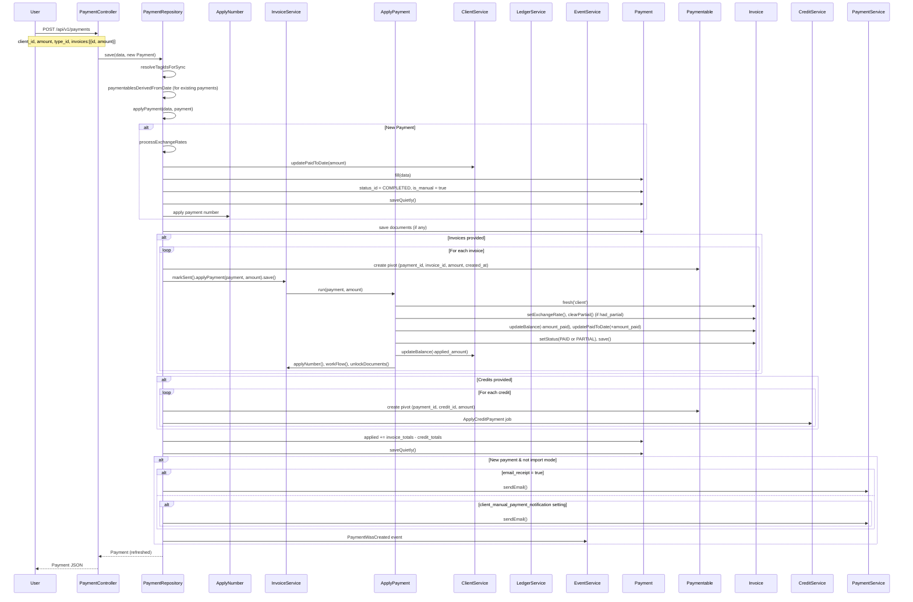
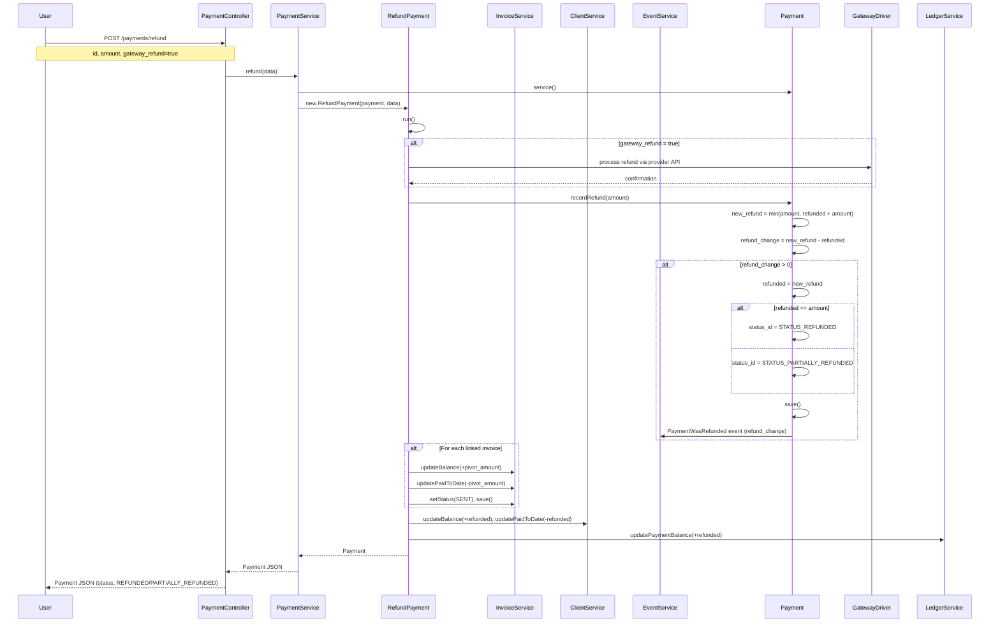

# InvoiceNinja v5.13.50 — Payment Management Module FRD

> **Source base:** `E:\invoiceninja-5.13.50`
> **Sources:** `app/Models/Payment.php`, `app/Repositories/PaymentRepository.php`, `app/Services/Payment/PaymentService.php`, `app/Services/Payment/ApplyNumber.php`, `app/Services/Invoice/MarkPaid.php`, `app/Services/Invoice/ApplyPayment.php`, `app/Models/Paymentable.php`, `app/Models/PaymentType.php`, `app/Http/Controllers/PaymentController.php`, `app/Http/Requests/Payment/StorePaymentRequest.php`, `app/Http/Requests/Payment/CreatePaymentRequest.php`, `routes/api.php`

---

## 1. System Overview & Boundaries

### Scope
**In-scope:**
- Payment creation (manual and gateway-based)
- Payment-to-invoice application (full, partial, overpayment)
- Payment-to-credit application
- Payment number generation
- Payment status lifecycle (pending, completed, failed, voided, refunded, partially refunded)
- Payment refunds (full and partial)
- Payment voiding
- Payment date change handling (with France regulatory compliance)
- Payment currency and exchange rate handling
- Payment email receipts
- Payment ledger management
- Gateway fee quoting and application

**Out-of-scope:**
- Payment gateway integration specifics (Stripe, PayPal, etc. — see `12_Integrations_FRD.md`)
- Bank transaction matching (see `12_Integrations_FRD.md` — Bank Transactions)
- Client portal payment flows (covered in Client Management FRD)

### Actors
| Actor | Role |
|---|---|
| **Authenticated User** | Manually creates/refunds/voids payments; applies payments to invoices |
| **Client (Portal User)** | Pays invoices via payment gateway through client portal |
| **Payment Gateway** | Sends webhook callbacks for payment status updates |
| **Cron/System** | Processes pending payments, gateway fee application |
| **QuickBooks Integration** | Syncs payment data |

### Triggers
| Trigger | Type | Source |
|---|---|---|
| `POST /api/v1/payments` | User action | Authenticated user |
| Gateway webhook | System | Payment gateway HTTP callback |
| `GET /api/v1/invoices/{id}/mark_paid` | User action | Invoice mark-paid flow (creates payment internally) |
| `POST /api/v1/payments/refund` | User action | Authenticated user initiating refund |

---

## 2. Functional Input/Output Matrix

| Trigger / Action | Input Data | Validation Rules | Expected Output / Side Effects |
|---|---|---|---|
| **Store Payment** (`POST /api/v1/payments`) | `client_id`, `amount`, `date`, `type_id`, `currency_id`, `exchange_rate`, `transaction_reference`, `private_notes`, `invoices[]`, `credits[]`, `company_gateway_id`, `payment_hash`, `email_receipt` | Client must be valid; amount must be numeric and ≥ 0; currency must match client or be specified; `amount` required if no invoices/credits provided; user has `create` permission on Payment | Payment created with `STATUS_COMPLETED` (if `is_manual`) or `STATUS_PENDING` (if gateway); Paymentable pivot records created for each invoice/credit; invoice balances updated via `applyPayment()`; client `balance` and `paid_to_date` updated; `PaymentWasCreated` event fired; if `email_receipt=true` → email dispatched |
| **Update Payment** (`PUT /api/v1/payments/{id}`) | Same fields as store, plus `status_id` override, `date` change | Must own company; user has `edit` permission; cannot change `amount` after payment if already applied | Payment record updated; if `date` changed and `france_reporting_enabled` → `PaymentApplicationDateChanged` event dispatched for affected invoices; paymentables' `created_at` adjusted if date changed |
| **Refund Payment** (`POST /api/v1/payments/refund`) | `id` (payment), `amount`, `gateway_refund` (bool), `transaction_reference` | Payment must be COMPLETED status; refund amount ≤ (amount - refunded); if `gateway_refund=true`, gateway must support refunds | Payment `refunded` amount updated; status → PARTIALLY_REFUNDED (partial) or REFUNDED (full); `PaymentWasRefunded` event fired; invoice balances reverted via paymentable reversal; client balance and paid_to_date updated |
| **Void Payment** (`DELETE /api/v1/payments/{id}`) | Payment ID | Payment must not be already voided/refunded; user has `delete` permission | `markVoided()`: sets `refunded = amount`, `status_id = STATUS_CANCELLED`; `PaymentWasVoided` event fired; invoice balances reverted; client balance restored |
| **Create Payment (from invoice)** | `invoice_id`, `amount`, `reference`, `type_id` | Invoice must be PAID/PARTIAL/SENT; valid amount | Calls `PaymentService::manualPayment()`; creates PaymentFactory; attaches to invoice; fires events |
| **Bulk Actions** (`POST /api/v1/payments/bulk`) | Action enum (`archive`, `restore`, `delete`, `refund`), `ids` array | User has bulk permission; payments in same company | Batch operation on selected payments; audit trail entries created |
| **Apply Gateway Fee** | `company_gateway_id`, `amount`, `gateway_type_id` | Gateway must be active; fee config exists | Fee calculated via `FeesAndLimits`; may be quoted without modifying invoice (pending confirmation) |

---

## 3. State Transition Matrix

> **Sources:** `app/Models/Payment.php` (§Status Constants, line 111-121), `app/Models/Payment.php` (`recordRefund()`, lines 419-443), `app/Models/Payment.php` (`markVoided()`, lines 466-477), `app/Services/Payment/PaymentService.php` (`reversePayment()`, lines 80-106), `app/Services/Payment/PaymentRepository.php` (`applyPayment()`, lines 185-353)

| Current State | Event / Trigger | Condition | New State | Actions Triggered |
|---|---|---|---|---|
| PENDING | Gateway confirmation | Gateway webhook receives success | COMPLETED | `completePendingPayment()` called; `PaymentWasCreated` event fired; invoices updated via `applyPayment()`; client balance and paid_to_date updated; `PaymentApplicationDateChanged` event if France reporting; if `email_receipt` or `client_manual_payment_notification` → email dispatched |
| PENDING | Gateway failure | Gateway webhook receives failure | FAILED | `PaymentWasFailed` event (if applicable); payment left as PENDING or moved to FAILED |
| PENDING | Gateway cancellation | User cancels; or timeout | CANCELLED (voided) | `markVoided()` called; amounts reversed; `PaymentWasVoided` event fired |
| PENDING | Manual completion | User marks as completed | COMPLETED | Same as gateway confirmation above |
| COMPLETED | Full refund | `refund()` with amount = (amount - refunded) | REFUNDED | `recordRefund()` sets `refunded = amount`, `status_id = STATUS_REFUNDED`; `PaymentWasRefunded` event fired with refund_change; invoice paymentables refunded; client balance and paid_to_date reverted |
| COMPLETED | Partial refund | `refund()` with amount < (amount - refunded) | PARTIALLY_REFUNDED | `recordRefund()` sets `refunded += amount`, `status_id = STATUS_PARTIALLY_REFUNDED`; `PaymentWasRefunded` event fired; proportional invoice reversal; client balance adjusted |
| COMPLETED | Void | `markVoided()` called | CANCELLED (voided) | Guards: already voided/refunded → returns false; sets `refunded = amount`; fires `PaymentWasVoided` event; `reversePayment()` reverts invoice balances and client paid_to_date |
| PARTIALLY_REFUNDED | Additional refund | `refund()` with new amount | PARTIALLY_REFUNDED or REFUNDED | If new_refunded == amount → REFUNDED; else stays PARTIALLY_REFUNDED; `recordRefund()` logic applied |
| PARTIALLY_REFUNDED | Void | Blocked | — | `isVoided()` returns true; `markVoided()` returns false; no action taken |
| REFUNDED | Void | Blocked | — | `isVoided()` returns true; `markVoided()` returns false |
| REFUNDED | Refund | Blocked | — | `isRefunded()` returns true; cannot refund again |
| COMPLETED | Update date | Payment date changed | COMPLETED (updated) | If `france_reporting_enabled` → `PaymentApplicationDateChanged` event for affected invoices; date change deferred if paymentables have derived dates |
| COMPLETED → CANCELLED | Delete/restore cycle | Soft-delete then restore | COMPLETED (if restored) | Paymentables restored; payment amounts re-adjusted; client balance recalculated |

### 3.1 State Transition Guards & Business Rules

1. **Double-void prevention:** `markVoided()` checks `isVoided() || isPartiallyRefunded() || isRefunded()` (line 468) → returns `false` if any true.
   - **Source:** `app/Models/Payment.php`, lines 466-477

2. **Refund amount cap:** `recordRefund()` calculates `$new_refund = min($this->amount, $this->refunded + $amount)` (line 431) — cannot exceed payment amount.
   - **Source:** `app/Models/Payment.php`, lines 419-443

3. **Refund detection:** `isRefunded()` = `status_id == STATUS_REFUNDED`; `isPartiallyRefunded()` = `status_id == STATUS_PARTIALLY_REFUNDED`.
   - **Source:** `app/Models/Payment.php`, lines 450-458

4. **Void = full refund internally:** `markVoided()` sets `refunded = $this->amount` (line 472) — effectively marks the full amount as refunded, then sets status to CANCELLED.

5. **Completed amount calculation:** `getCompletedAmount()` = `amount - refunded` (line 414-417) — represents the net applied amount after refunds.

6. **Payment application to invoices:** When a payment is applied to an invoice via `PaymentRepository::applyPayment()` (lines 260-303):
   - Creates `Paymentable` pivot with `amount` and `created_at` (business date)
   - Calls `Invoice::service()->markSent()->applyPayment(payment, amount)->save()`
   - If `france_reporting_enabled` → records payment movement via `FrancePaymentApplicationRecorder`

7. **Payment application to credits:** Similar to invoices (lines 308-336):
   - Creates `Paymentable` pivot linking payment to credit
   - Calls `ApplyCreditPayment` job to apply credit
   - Credits reduce the effective payment amount applied (`applied += invoice_totals - credit_totals`)

8. **Date change handling for France reporting:** `PaymentRepository::save()` (lines 60-91):
   - Detects if `data['date']` differs from `payment->date`
   - Collects affected `Paymentable` records whose `created_at` was derived from the original payment date
   - Defers date change on the payment itself, adjusts paymentable `created_at` timestamps
   - Dispatches `PaymentApplicationDateChanged` event with original_date, new_date, and paymentable IDs

9. **Initial payment status:** In `PaymentRepository::applyPayment()` (line 233): `$payment->status_id = Payment::STATUS_COMPLETED` — all manually created payments are immediately COMPLETED (not PENDING). Gateway payments start as PENDING and transition to COMPLETED upon webhook confirmation.

10. **Client balance update on payment creation:** Called once per new payment (line 209): `$client->service()->updatePaidToDate($data['amount'])->save()` — increases client's `paid_to_date` by the payment amount.

---

## 4. Business Logic & Rule Extraction

### 4.1 Payment Number Generation

> **Source:** `app/Services/Payment/ApplyNumber.php`

```
applyNumber()
├─ Uses company settings: payment_number_prefix, payment_number_suffix, payment_counter
├─ Increments company counter
├─ Formats: {prefix}{padded_counter}{suffix}
└─ Sets payment.number
```

- Numbers are generated immediately when a payment is created (not deferred to send)
- Counter is company-scoped and sequential
- If payment already has a number, it is preserved (idempotent)

### 4.2 Payment-to-Invoice Application Logic

> **Source:** `app/Services/Invoice/ApplyPayment.php` (full implementation)

When a payment is applied to an invoice:

```
ApplyPayment::run(payment, amount)
├─ invoice = invoice->fresh('client')
├─ amount_paid = 0
├─ had_partial = invoice->hasPartial()
│
├─ IF had_partial AND amount < invoice.partial:
│   │  STAGE 1: Underpaying the deposit
│   ├─ amount_paid = amount × -1
│   ├─ updatePartial(amount_paid) — reduces partial field
│   ├─ updateBalance(amount_paid) — reduces balance
│   ├─ updatePaidToDate(amount_paid × -1) — increases paid_to_date
│   └─ save
│
├─ ELSE:
│   │  STAGE 2-4: Standard payment application
│   ├─ IF amount == balance:  amount_paid = amount × -1, status = PAID
│   ├─ IF amount < balance:   amount_paid = amount × -1, status = PARTIAL
│   └─ IF amount > balance:   amount_paid = balance × -1, status = PAID (cap at balance)
│   │
│   ├─ IF had_partial: clearPartial(), setDueDate()
│   ├─ setStatus(status)
│   ├─ updateBalance(amount_paid)
│   ├─ updatePaidToDate(amount_paid × -1)
│   └─ save
│
├─ IF had_partial: checkReminderStatus() — resets reminders if partial fully paid
│
├─ ledger: updatePaymentBalance(amount_paid, "ApplyPaymentInvoice")
├─ client: updateBalance(amount_paid) — reduces client balance
├─ invoice: applyNumber(), workFlow(), unlockDocuments(), save()
└─ return invoice
```

### 4.3 Payment Currency Handling

> **Source:** `app/Repositories/PaymentRepository.php` (`processExchangeRates()`, lines 362-386)

```
processExchangeRates(data, payment)
├─ IF exchange_rate already set AND ≠ 1: return (already specified)
├─ client_currency = client->getSetting('currency_id')
├─ company_currency = client->company->settings->currency_id
├─ IF client_currency ≠ company_currency:
│   ├─ exchange_rate = CurrencyApi.exchangeRate(client, company, payment_date)
│   ├─ payment->exchange_rate = calculated rate
│   ├─ payment->exchange_currency_id = company_currency
│   ├─ payment->currency_id = client_currency
│   └─ return (converted)
├─ ELSE:
│   ├─ payment->currency_id = company_currency
│   └─ return (rate = 1)
```

### 4.4 Payment Date Change Deferral

> **Source:** `app/Repositories/PaymentRepository.php` (lines 60-91)

When updating an existing payment with a new date:

1. `original_date` = payment's current date
2. `paymentables_to_move` = Paymentable records whose `created_at` was derived from `original_date` (resolved via `PaymentApplicationDateResolver`)
3. If date is changing AND there are paymentables to move AND this is an existing payment:
   - Temporarily set `applied_data['date'] = original_date` (defer the actual change)
   - Apply payment with original date
   - Call `movePaymentableDates()` with the new date in a DB transaction:
     - Updates each paymentable's `created_at` to the encoded business date
     - If France reporting enabled: records the date change via `FrancePaymentApplicationRecorder::recordApplicationDateChange()` with a UUID identity
4. `PaymentApplicationDateChanged` event dispatched with original_date, new_date, and affected paymentable IDs

### 4.5 Payment Refund Logic

> **Source:** `app/Models/Payment.php` (`recordRefund()`, lines 419-443), `app/Services/Payment/RefundPayment.php`

```
refund(data)
├─ payment = payment->service()
├─ data contains: amount, reference, gateway_refund
├─ IF gateway_refund AND company_gateway supports refunds:
│   ├─ Delegate to gateway driver for actual refund
│   └─ Gateway processes refund via provider API
├─ recordRefund(amount)
│   ├─ new_refund = min(payment.amount, payment.refunded + amount)
│   ├─ refund_change = new_refund - payment.refunded
│   ├─ IF refund_change > 0:
│   │   ├─ payment.refunded = new_refund
│   │   ├─ payment.status_id = (refunded == amount) ? STATUS_REFUNDED : STATUS_PARTIALLY_REFUNDED
│   │   ├─ payment.save()
│   │   └─ PaymentWasRefunded event fired
│   └─ return true
├─ Reverse invoice balances for refunded amount
├─ Reverse client balance for refunded amount
└─ ledger: updatePaymentBalance(+refunded_amount)
```

### 4.6 Payment Voiding (Reverse Payment)

> **Source:** `app/Models/Payment.php` (`markVoided()`, lines 466-477), `app/Services/Payment/PaymentService.php` (`reversePayment()`, lines 80-106)

```
markVoided()
├─ Guards: if isVoided() OR isPartiallyRefunded() OR isRefunded() → return false
├─ payment.refunded = payment.amount (treat as fully "refunded")
├─ payment.status_id = STATUS_CANCELLED
├─ payment.save()
├─ PaymentWasVoided event fired
└─ return true

reversePayment()
├─ For each invoice linked to payment:
│   ├─ IF pivot.amount > 0:
│   │   ├─ invoice.updateBalance(+pivot.amount)  — restore balance
│   │   ├─ invoice.updatePaidToDate(-pivot.amount)  — reduce paid_to_date
│   │   └─ invoice.setStatus(SENT)  — revert from PAID
│   └─ save invoice
├─ ledger: updatePaymentBalance(+payment.amount, "PaymentService")
├─ client: updateBalance(+payment.amount), updatePaidToDate(-payment.amount)
└─ save client
```

### 4.7 Gateway Fee Quoting

> **Source:** `app/Services/Invoice/InvoiceService.php` (`quoteGatewayFee()`, lines 125-128), `app/DataMapper/FeesAndLimits.php`

Gateway fees are calculated using `FeesAndLimits` configuration:

```
quoteGatewayFee(company_gateway, gateway_type_id, amount)
├─ fees_and_limits = company_gateway->getFeesAndLimits(gateway_type_id)
├─ IF not enabled OR amount outside [min_limit, max_limit]: return error
├─ net = amount
├─ fee_amount = fees_and_limits.fee_amount (flat)
├─ fee_percent = amount × (fees_and_limits.fee_percent / 100)
│   └─ IF adjust_fee_percent: fee_percent = (amount + fee_amount) × (percent/100) / (1 - percent/100)
├─ fee_tax = calculated tax on fee_amount + fee_percent using fee_tax_name/rate1-3
├─ gross = net + fee_amount + fee_percent + fee_tax
│   └─ IF fee_cap > 0 AND (fee_amount + fee_percent) > fee_cap:
│       └─ fee_percent = fee_cap - fee_amount
└─ return {net, gross}
```

**Key rule:** The fee is quoted (returned as a calculation) but does NOT modify the invoice until the payment is confirmed. This prevents fee lines on unpaid invoices.

---

## 5. Step-by-Step Functional Workflows

### 5.1 Create Manual Payment with Invoice Application (Happy Path)

1. **Pre-conditions:**
   - Authenticated user with `create` permission on Payment
   - Valid `client_id`
   - Payment amount > 0
   - At least one invoice in the `invoices` array (or credits)

2. **Execution Steps:**
   - Step 1: `POST /api/v1/payments` with `client_id`, `amount`, `type_id`, `currency_id`, `invoices: [{invoice_id, amount}]`
   - Step 2: `PaymentRepository::save()` called
   - Step 3: Resolve and sync tag IDs
   - Step 4: Check if `date` changed from original → defer if paymentables exist
   - Step 5: `applyPayment(data, payment)`:
     - If new payment: `processExchangeRates()` to set currency and exchange rate
     - Update client `paid_to_date` by `amount` (one-time, line 209)
     - If credits provided: update `paid_to_date` by credit totals
     - Fill payment model with data
     - Set `is_manual = true`, `status_id = STATUS_COMPLETED`
     - Determine currency (client setting or company default)
     - Save payment
     - Generate payment number if missing
     - Save documents if provided
     - **Iterate invoices:** For each invoice:
       - Create `Paymentable` pivot record with amount and business date
       - Call `Invoice::service()->markSent()->applyPayment(payment, amount)->save()`
       - If France reporting → record payment movement
     - **Iterate credits:** For each credit:
       - Create `Paymentable` pivot record
       - Call `ApplyCreditPayment` job
     - Set `payment.applied += invoice_totals - credit_totals`
     - If new payment (not existing, not import mode):
       - If `email_receipt` or `client_manual_payment_notification` → send email
       - Fire `PaymentWasCreated` event
   - Step 6: If date was deferred: `movePaymentableDates()` executes, updating paymentable timestamps and firing `PaymentApplicationDateChanged` event
   - Step 7: Return refreshed payment object

3. **Post-conditions:**
   - Payment exists with COMPLETED status
   - Payment number generated
   - Paymentable records link payment to invoices/credits
   - Invoice balances reduced (or PAID if zero)
   - Client balance and paid_to_date updated
   - `PaymentWasCreated` event fired
   - Email receipt sent (if configured)

### 5.2 Payment Gateway Callback (Webhook) — Payment Completion

1. **Pre-conditions:**
   - Payment exists in PENDING status
   - Gateway webhook delivers success notification
   - Payment hash matches

2. **Execution Steps:**
   - Step 1: Gateway webhook received at `payment_webhook/{company_key}/{company_gateway_id}`
   - Step 2: `PaymentDriver::processWebhook()` matches payment hash
   - Step 3: Payment status updated to COMPLETED
   - Step 4: `PaymentService::completePendingPayment()` called:
     - Checks `status_id == STATUS_PENDING` → proceeds
     - Sets `status_id = STATUS_COMPLETED`, saves
   - Step 5: `PaymentRepository::applyPayment()` applies payment to linked invoices:
     - Creates/updates Paymentable records
     - Calls `Invoice::service()->applyPayment()` for each invoice
     - Updates invoice balances, statuses (PARTIAL or PAID)
     - Updates client balance and paid_to_date
   - Step 6: `PaymentWasCreated` event fired (for the completion)
   - Step 7: If `email_receipt` enabled → email dispatched
   - Step 8: Ledger entries created for payment and invoice balance changes

3. **Post-conditions:**
   - Payment status = COMPLETED
   - Invoice(s) paid or partially paid
   - Client balances updated
   - Email receipt sent (if configured)

### 5.3 Full Refund of a Completed Payment

1. **Pre-conditions:**
   - Payment status = COMPLETED (not voided, not already refunded)
   - User has `edit` permission on the payment
   - Gateway supports refund (if `gateway_refund=true`)

2. **Execution Steps:**
   - Step 1: `POST /api/v1/payments/refund` with `id`, `amount` (optional, defaults to full), `gateway_refund=true`
   - Step 2: `PaymentController::refund()` calls `PaymentService::refundPayment()`
   - Step 3: `RefundPayment` job dispatched
   - Step 4: If `gateway_refund=true`:
     - Gateway driver processes refund via provider API
     - Gateway confirms refund
   - Step 5: `recordRefund(amount)` called:
     - `new_refund = min(payment.amount, payment.refunded + amount)`
     - `refund_change = new_refund - payment.refunded`
     - If `refund_change > 0`:
       - `payment.refunded = new_refund`
       - `payment.status_id = STATUS_REFUNDED` (if fully refunded) or `STATUS_PARTIALLY_REFUNDED`
       - Save payment
       - Fire `PaymentWasRefunded` event with `refund_change`
   - Step 6: Reverse invoice balances:
     - For each invoice linked via Paymentable: `updateBalance(+pivot_amount)`, `updatePaidToDate(-pivot_amount)`, status → SENT
   - Step 7: Reverse client balance: `client->updateBalance(+refunded_amount)`, `client->updatePaidToDate(-refunded_amount)`
   - Step 8: Ledger: `updatePaymentBalance(+refunded_amount)` (reverses the previous reduction)

3. **Post-conditions:**
   - Payment status = REFUNDED (or PARTIALLY_REFUNDED)
   - Invoice(s) revert to SENT/PARTIAL status
   - Invoice balances restored
   - Client balance and paid_to_date restored
   - `PaymentWasRefunded` event fired

### 5.4 Void a Payment

1. **Pre-conditions:**
   - Payment status = COMPLETED or PENDING
   - Payment is NOT already voided, refunded, or partially refunded
   - User has `delete` permission

2. **Execution Steps:**
   - Step 1: `DELETE /api/v1/payments/{id}` triggers `PaymentRepository::delete()`
   - Step 2: `PaymentService::deletePayment()` → `DeletePaymentV2` job
   - Step 3: `markVoided()` called:
     - Guards check: `isVoided()` || `isPartiallyRefunded()` || `isRefunded()` → return false if any true
     - Sets `refunded = amount`
     - Sets `status_id = STATUS_CANCELLED`
     - Saves payment
     - Fires `PaymentWasVoided` event
   - Step 4: `reversePayment()`:
     - For each linked invoice: restores balance, reduces paid_to_date, reverts to SENT
     - Ledger: restores payment balance entry
     - Client: `updateBalance(+amount)`, `updatePaidToDate(-amount)`
   - Step 5: Invoice restoration and status recalculation
   - Step 6: `PaymentWasDeleted` event fired

3. **Post-conditions:**
   - Payment status = CANCELLED (voided)
   - Invoice balances and statuses reverted
   - Client balance and paid_to_date restored
   - Ledger entries reversed

---

## 6. Edge Cases & Error Behaviors

| Case ID | Description | Expected Handling |
|---|---|---|
| **PC-001** | Payment is already voided when void is attempted | `markVoided()` checks `isVoided()` at entry (line 468) → returns `false`; no further action |
| **PC-002** | Payment is partially refunded when void is attempted | `isPartiallyRefunded()` check returns true → `markVoided()` returns `false` |
| **PC-003** | Payment is fully refunded when void is attempted | `isRefunded()` check returns true → `markVoided()` returns `false` |
| **PC-004** | Refund amount exceeds (amount - refunded) | `recordRefund()` caps at `min(amount, refunded + requested)` (line 431); excess silently truncated |
| **PC-005** | Refund with no amount specified | Defaults to full amount: `amount = null` → `amount = $this->amount` (line 427-428) |
| **PC-006** | Payment created without invoices or credits | If `amount` is empty and no invoices → client `paid_to_date` still updated by amount; if amount empty → defaults from `data['amount']` |
| **PC-007** | Payment with different currency than company | `processExchangeRates()` fetches real-time rate from `CurrencyApi`; `exchange_currency_id` set to company currency; `currency_id` set to client currency |
| **PC-008** | Payment date change with existing paymentables | Date change deferred; paymentables' `created_at` timestamps moved to encoded business date of new payment date; `PaymentApplicationDateChanged` event dispatched |
| **PC-009** | Payment with France reporting enabled and date change | `FrancePaymentApplicationRecorder::recordApplicationDateChange()` called for each affected paymentable; UUID-based identity for audit trail |
| **PC-010** | Payment refund when no invoice linked | Refund still proceeds on the payment itself; no invoice balance changes occur |
| **PC-011** | Payment delete when has associated gateway transaction | If `transaction_id` is set, gateway refund may be required before deletion; otherwise soft-delete only |
| **PC-012** | Overpayment — payment amount > invoice balance | Payment capped at invoice balance via `ApplyPayment::run()` Stage 4 (line 56-59); excess remains as `payment_balance` on client (unapplied payment) |
| **PC-013** | Payment with `amount == ''` (empty) and invoices provided | `array_sum(array_column(invoices, 'amount'))` used to infer total amount (line 205-207) |
| **PC-014** | Payment creation during import mode | `import_mode` flag skips invoice/credit paymentables iteration (line 227-228); no email sent; `PaymentWasCreated` event still fired |
| **PC-015** | Payment with `company_gateway_id` linked | Payment is gateway-anchored; status starts as PENDING; transitions to COMPLETED via webhook; `gateway_type_id` set from gateway configuration |
| **PC-016** | Gateway fee exceeds cap | `fee_cap` enforced in `FeesAndLimits`; if `fee_amount + fee_percent` exceeds `fee_cap`, `fee_percent` is capped at `fee_cap - fee_amount` |
| **PC-017** | Payment application with zero amount | `ApplyPayment::run()`: if `payment_amount == 0`, `amount_paid = 0`; balance unchanged; status recalculated by `setCalculatedStatus()` |
| **PC-018** | Payment restoration after soft-delete | `PaymentRepository::restore()`: if payment is deleted → returns without restoring (line 406-408); paymentables must be restored via invoice restoration |

---

## 7. Sequence Diagrams (Mermaid)

### 7.1 Payment Creation with Invoice Application



### 7.2 Payment Refund Flow



---

## 8. API Endpoint Specifications

### 8.1 POST `/api/v1/payments` — Create Payment

**Request Body:**
```json
{
  "client_id": "hashed_client_id",
  "amount": 100.00,
  "type_id": 1,
  "currency_id": 1,
  "date": "2024-01-15",
  "transaction_reference": "Check #1234",
  "private_notes": "Payment received in person",
  "invoices": [
    {
      "invoice_id": 123,
      "amount": 100.00
    }
  ],
  "email_receipt": true,
  "custom_value1": null,
  "custom_value2": null,
  "custom_value3": null,
  "custom_value4": null
}
```

**Response:** Payment JSON object with `status_id`, `applied`, `number`, and linked invoices/credits.

### 8.2 POST `/api/v1/payments/refund`

**Request Body:**
```json
{
  "id": "hashed_payment_id",
  "amount": 50.00,
  "gateway_refund": true,
  "transaction_reference": "Refund reference"
}
```

### 8.3 DELETE `/api/v1/payments/{payment}`

Voiding a payment. No request body. Returns voided payment object.

### 8.4 POST `/api/v1/payments/bulk`

**Request Body:**
```json
{
  "action": "archive|restore|delete|refund",
  "ids": ["hash1", "hash2"]
}
```

---

## 9. Payment Type Classification

> **Source:** `app/Models/PaymentType.php`

Payment types are classified into gateway types:

| ID | Name | Gateway Type ID | Category |
|---|---|---|---|
| 1 | Bank Transfer | 2 | Bank transfer |
| 2 | Cash | null | Manual cash |
| 3 | Debit | 1 | Card (debit) |
| 5-12, 16-22, 23 | Various card types | 1 | Card (credit/debit) |
| 13 | PayPal | 3 | Digital wallet |
| 4, 24, 28, 29, 30, 34-37, 39-45, 46, 48-50 | Various bank transfers | 2 | Bank transfer |
| 27 | Alipay | 7 | Digital wallet |
| 31 | Crypto | 4 | Cryptocurrency |
| 32 | Credit | 14 | Credit-based |
| 47 | Klarna | 14 | Buy-now-pay-later |
| 52 | Pay Later | 14 | Buy-now-pay-later |
| 53 | Mobile Payment | 30 | Mobile |
| 54 | PromptPay | 31 | Mobile |

**Gateway Type IDs:**
- 1 = Credit/Debit Card
- 2 = Bank Transfer (ACH, SEPA, etc.)
- 3 = PayPal
- 4 = Cryptocurrency
- 7 = Alipay
- 8 = Sofort
- 9 = SEPA
- 10 = GoCardless
- 14 = Credit (Klarna, etc.)
- 30 = Mobile Payment
- 31 = PromptPay

---

## Source Files Referenced

| Source | File |
|---|---|
| Payment model | `app/Models/Payment.php` |
| Payment repository | `app/Repositories/PaymentRepository.php` |
| Payment service | `app/Services/Payment/PaymentService.php` |
| Payment number | `app/Services/Payment/ApplyNumber.php` |
| Payment types | `app/Models/PaymentType.php` |
| Paymentable pivot | `app/Models/Paymentable.php` |
| Fees and limits | `app/DataMapper/FeesAndLimits.php` |
| MarkPaid service | `app/Services/Invoice/MarkPaid.php` |
| ApplyPayment service | `app/Services/Invoice/ApplyPayment.php` |
| MarkSent service | `app/Services/Invoice/MarkSent.php` |
| Payment controller | `app/Http/Controllers/PaymentController.php` |
| Store payment request | `app/Http/Requests/Payment/StorePaymentRequest.php` |
| Create payment request | `app/Http/Requests/Payment/CreatePaymentRequest.php` |
| API routes | `routes/api.php` |
| Client service | `app/Services/Client/ClientService.php` |
| FrancePaymentApplicationRecorder | `app/Services/EDocument/Standards/France/FrancePaymentApplicationRecorder.php` |
| PaymentApplicationDateResolver | `app/Services/Payment/PaymentApplicationDateResolver.php` |
