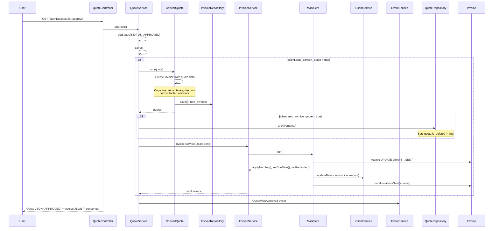

# InvoiceNinja v5.13.50 — Quote, Credit & Pricing Engine FRD

> **Source base:** `E:\invoiceninja-5.13.50`
> **Sources:** `app/Models/Quote.php`, `app/Services/Quote/QuoteService.php`, `app/Services/Quote/TriggeredActions.php`, `app/Services/Quote/ConvertQuote.php`, `app/Services/Quote/SendEmail.php`, `app/Models/Credit.php`, `app/Services/Credit/CreditService.php`, `app/Services/Credit/CreditRepository.php`, `app/Services/Invoice/ApplyPayment.php`, `app/Services/Payment/PaymentService.php` (`applyCreditsToInvoice`), `app/DataMapper/InvoiceItem.php`, `app/Helpers/Invoice/Discounter.php`, `app/Helpers/Invoice/Taxer.php`

---

## 1. System Overview & Boundaries

### Scope
**In-scope:**
- Quote creation, storage, sending, approval, rejection, and conversion to invoice
- Quote expiration handling
- Credit (credit note) creation from invoices, application to invoices, and email delivery
- Pricing engine: line item calculation, discounts (item-level and invoice-level), tax calculation (inclusive and exclusive), currency conversion, and rounding
- Recurring quote templates

**Shared scope with Invoice module:**
- The calculation engine (`InvoiceSum`, `Discounter`, `Taxer`) is shared by all document types (invoices, quotes, credits, purchase orders)

### Actors
| Actor | Role |
|---|---|
| **Authenticated User** | Creates quotes/credits, sends, approves, converts |
| **Client (Portal User)** | Receives, views, approves, or rejects quotes; receives credit notes |
| **System (Cron)** | Handles quote expiration, recurring quote generation |

### Triggers
| Trigger | Type | Source |
|---|---|---|
| `POST /api/v1/quotes` | User action | API/UI |
| `GET /api/v1/quotes/{id}/{action}` | User action | approve, reject, email, convert |
| Invoice conversion | System | From quote approval or manual conversion |
| Cron expiration check | Scheduled | Daily cron evaluating `due_date` |

---

## 2. Quote Module — Full Specification

### 2.1 System Overview & Boundaries

#### Scope
- Quote creation from client, line items, taxes, discounts
- Quote status lifecycle: DRAFT → SENT → APPROVED/REJECTED/EXPIRED
- Quote-to-invoice conversion with optional auto-archive
- Quote sending via email with contact-specific invitations
- Quote approval by client (portal)

#### Actors
- **Authenticated User**: Creates, sends, converts, cancels quotes
- **Client (Portal User)**: Views, approves, or rejects quotes via secure link
- **System**: Handles expiration based on `due_date`

### 2.2 Functional Input/Output Matrix

| Trigger / Action | Input Data | Validation Rules | Expected Output / Side Effects |
|---|---|---|---|
| **Store Quote** (`POST /api/v1/quotes`) | `client_id`, `line_items[]`, `date`, `due_date`, `terms`, `footer`, `discount`, `is_amount_discount`, `tax_name1-3`, `tax_rate1-3`, `po_number`, `custom_value1-4`, `notes`, `assigned_user_id`, `project_id`, `location_id`, `design_id` | Client must be valid & accessible; `due_date` set for expiration; user has `create` permission | Quote created in DRAFT state; calculations via `InvoiceSum`; `amount` and `total_taxes` set; balance = amount |
| **Update Quote** (`PUT /api/v1/quotes/{quote}`) | Same as store | Must be DRAFT, SENT, or EXPIRED; not already CONVERTED; user has edit permission | Fields updated; amounts recalculated |
| **Send Quote** (`GET /api/v1/quotes/{quote}/send_email`) | Optional: `contact_id`, `save_default_terms=true`, `save_default_footer=true` | Quote must be DRAFT or SENT; client has valid email | Status → SENT (if DRAFT); `markSent()` called; email dispatched to contact; if Verifactu enabled → `sendVerifactu()`; if `save_default_terms` → company settings updated |
| **Approve Quote** (`GET /api/v1/quotes/{quote}/approve`) | Optional: implicit (from portal) | Must be SENT status; not EXPIRED or CANCELLED | Status → APPROVED; if `auto_convert_quote` on client → auto-converts to invoice and marks it sent; fires `QuoteWasApproved` event |
| **Reject Quote** (`GET /api/v1/quote/{key}/reject`) | Optional: `notes` | Must be SENT status | Status → REJECTED; fires `QuoteWasRejected` event with notes |
| **Convert to Invoice** (`GET /api/v1/quotes/{quote}/convert`) | None | `isConvertable()` must return true (not already converted, not EXPIRED/CANCELLED) | New Invoice created from quote data; quote optionally archived (`auto_archive_quote` setting); `QuoteConversion` exception if already converted |
| **Cancel Quote** (`GET /api/v1/quotes/{quote}/cancel`) | Optional: `reason` | Must be SENT status | Status → CANCELLED; fires `QuoteWasCancelled` event |
| **Accept on Portal** | Contact key + quote key from URL | Valid contact key; quote not expired (if due_date passed) | Status → APPROVED (then auto-convert if setting enabled) |
| **Download PDF** (`GET /api/v1/quote/{key}/download`) | Quote key | Valid key; not deleted | PDF generated and returned for download |
| **Bulk Actions** (`POST /api/v1/quotes/bulk`) | Action enum + IDs | User has bulk permission | Batch operation applied |

### 2.3 State Transition Matrix

> **Source:** `app/Models/Quote.php` (§Status Constants), `app/Services/Quote/QuoteService.php` (`approve()` lines 130-150, `reject()` lines 153-169, `cancel()` lines 171-182, `convert()` lines 61-79, `isConvertable()` lines 214-225)

| Current State | Event / Trigger | Condition | New State | Actions Triggered |
|---|---|---|---|---|
| DRAFT | Send | Client has valid email; SMTP configured | SENT | `markSent()` → status update, number application, due date set, invitations created; email dispatched; `sendEmail()` triggered |
| DRAFT | Approve | — | APPROVED → may auto-convert | `setStatus(APPROVED)->save()`; if `auto_convert_quote` → `convertToInvoice()` → `markSent()->save()`; `QuoteWasApproved` event |
| DRAFT | Cancel | — | CANCELLED | Only if status is SENT (guard at line 173); DRAFT → returns unchanged (line 173: `if ($this->quote->status_id !== Quote::STATUS_SENT) return $this`) |
| DRAFT | Convert | `isConvertable()` true | APPROVED (transient) → new Invoice DRAFT | `ConvertQuote` service creates invoice from quote; if `auto_archive_quote` → quote archived via `QuoteRepository::archive()` |
| DRAFT | Restore | Must be soft-deleted | DRAFT (or previous state) | Reverses soft-delete; quote number wound back |
| SENT | Approve | Not EXPIRED, not CANCELLED | APPROVED | `QuoteWasApproved` event; if `auto_convert_quote` → invoice created and auto-marked sent |
| SENT | Reject | Status must be SENT | REJECTED | `QuoteWasRejected` event with notes |
| SENT | Convert | `isConvertable()` true | APPROVED (transient) → new Invoice DRAFT | Quote archived if `auto_archive_quote`; invoice `markSent()` if auto-convert |
| SENT | Cancel | Must be SENT | CANCELLED | `QuoteWasCancelled` event fired; quote archived |
| SENT | Expire | `due_date` in past | EXPIRED | Auto by system cron; quote archived if `auto_archive_quote` |
| SENT | Download | Valid quote key | SENT (no change) | PDF generated; `last_viewed` updated if portal access | 
| SENT | View on portal | Valid contact + quote key | SENT (view recorded) | `last_viewed` timestamp set; `markViewed()` called |
| APPROVED | Convert | Not already converted | CONVERTED | Invoice created; quote status → CONVERTED |
| APPROVED | Reject | Guard blocks | APPROVED (unchanged) | `reject()` returns `$this` unchanged if status ≠ SENT (line 156) |
| REJECTED | Approve | Guard blocks | REJECTED (unchanged) | `approve()` checks `status_id` only for conversion; status already set |
| EXPIRED | Convert | `isConvertable()` → false | EXPIRED (blocked) | Returns false; no conversion |
| CONVERTED | Any | Terminal | — | `isConvertable()` returns false; all actions rejected |

### 2.4 Quote Lifecycle Details

#### 2.4.1 Quote Approval — `QuoteService::approve()`

> **Source:** `app/Services/Quote/QuoteService.php`, lines 130-150

```
approve(contact)
├─ setStatus(STATUS_APPROVED) → save
├─ IF no contact provided: contact = invitations->first()->contact
├─ IF client.auto_convert_quote = true:
│   ├─ convertToInvoice() → calls convert()
│   │   └─ invoice->service()->markSent()->save()
│   └─ Fire QuoteWasApproved event (includes auto-converted invoice)
└─ ELSE: Fire QuoteWasApproved event
```

**Key rule:** Quote approval triggers `QuoteWasApproved` event. If `auto_convert_quote` is enabled on the client's settings, the quote is immediately converted to an invoice and the invoice is marked as SENT.

#### 2.4.2 Quote Rejection — `QuoteService::reject()`

> **Source:** `app/Services/Quote/QuoteService.php`, lines 153-169

```
reject(contact, notes)
├─ IF status_id ≠ STATUS_SENT → return $this (no action)
├─ setStatus(STATUS_REJECTED) → save
├─ IF no contact: contact = invitations->first()->contact
└─ Fire QuoteWasRejected event (with notes)
```

**Key rule:** Rejection only works on SENT quotes. Once rejected, a quote cannot be approved (guard in `approve()` only checks for already-converted state).

#### 2.4.3 Quote Conversion — `QuoteService::convert()` → `QuoteService::convertToInvoice()`

> **Source:** `app/Services/Quote/QuoteService.php`, lines 61-79, 205-212

```
convert()
├─ IF quote.invoice_id is set → throw QuoteConversion exception (already converted)
├─ convert_quote = (new ConvertQuote(quote.client))->run(quote)
│   └─ Creates new Invoice from quote data
│      Sets: client_id, line_items, tax fields, discount, terms, footer, dates
│      Marks as DRAFT initially
├─ quote.fresh() — reload
├─ IF client.auto_archive_quote = true:
│   └─ QuoteRepository::archive(quote)
└─ return (self, with invoice set)
```

**Key rule:** A quote can only be converted once. The `QuoteConversion` exception prevents double-conversion. After conversion, the original quote is archived if `auto_archive_quote` is enabled.

#### 2.4.4 Quote Convertibility Check — `QuoteService::isConvertable()`

> **Source:** `app/Services/Quote/QuoteService.php`, lines 214-225

A quote is convertible if:
1. `invoice_id` is null (not already converted)
2. `status_id` is NOT `STATUS_EXPIRED` or `STATUS_CANCELLED`

---

## 3. Credit Module — Full Specification

### 3.1 System Overview & Boundaries

#### Scope
- Credit (credit note / refund) creation from fully-paid invoices
- Credit application to outstanding invoices (reduces invoice balance)
- Credit application via payments (credits can be applied as part of payment)
- Credit status lifecycle: DRAFT → SENT → PARTIAL → APPLIED
- Credit email delivery to client contact

#### Actors
- **Authenticated User**: Creates, sends, applies credits; generates from invoices
- **Client (Portal User)**: Receives and downloads credit notes
- **System**: Handles credit expiration (based on `due_date`)

### 3.2 Functional Input/Output Matrix

| Trigger / Action | Input Data | Validation Rules | Expected Output / Side Effects |
|---|---|---|---|
| **Store Credit** (`POST /api/v1/credits`) | `client_id`, `invoice_id` (parent), `line_items[]`, `date`, `due_date`, `terms`, `discount`, `is_amount_discount`, `tax_name1-3`, `tax_rate1-3`, `notes` | Client must be valid; user has `create` permission on Credit | Credit created in DRAFT state; `amount` = calculated total; `balance` = amount; `invoice_id` set if generated from invoice |
| **Update Credit** (`PUT /api/v1/credits/{credit}`) | Same as store | Must be DRAFT, SENT, or PARTIAL; not already APPLIED | Fields updated; amounts recalculated |
| **Send Credit** (`GET /api/v1/credit/{key}/download` for view, or action=email) | Optional: `contact_id` | Credit must be DRAFT or SENT | Status → SENT (if DRAFT); email dispatched; `markInvitationsSent()` |
| **Apply Credit to Invoice** (via payment) | `credit_id`, `invoice_id`, `amount` | Credit balance > 0; invoice has balance; credit not expired | Credit applied: credit `balance` reduced by amount; invoice `balance` reduced; `Paymentable` pivot with `paymentable_type=Credit::class` |
| **Apply Credit to Invoice** (standalone) | `credit_id`, `amount` | Credit balance > 0; invoice has balance | Credit balance → 0 (if fully applied) → status APPLIED; invoice balance reduced; `Paymentable` created |
| **Cancel Credit** (`GET /api/v1/credits/{credit}`) | Action = cancel | Credit must not be APPLIED or expired | Status → CANCELLED; credit balance restored to original |

### 3.3 State Transition Matrix

> **Source:** `app/Models/Credit.php` (§Status Constants, lines 225-231), `app/Models/Credit.php` (`updateBalance()`, lines 396-427)

| Current State | Event / Trigger | Condition | New State | Actions Triggered |
|---|---|---|---|---|
| DRAFT | Send | Valid email; SMTP configured | SENT | `markSent()`; invitations sent; email dispatched |
| DRAFT | Apply | Valid invoice; credit has balance | APPLIED (or PARTIAL if partial) | Credit balance reduced; invoice balance reduced; `Paymentable` pivot created |
| SENT | Apply | Credit has remaining balance | PARTIAL → APPLIED | `Paymentable` pivot created linking credit to invoice; credit `balance` updated; `status_id = STATUS_APPLIED` when `balance == 0` |
| SENT | Cancel | Not already applied | CANCELLED | Status → CANCELLED |
| PARTIAL | Apply more | Still has balance | PARTIAL → APPLIED | Same as SENT; when balance reaches 0 → APPLIED |
| APPLIED | Any action | Terminal | — | `isConvertable()` equivalent: balance = 0, no further actions |

### 3.4 Credit Status Determination Logic

> **Source:** `app/Models/Credit.php`, `updateBalance()` method (lines 396-427)

```
updateBalance(balance_adjustment)
├─ IF is_deleted → return
├─ balance += balance_adjustment
├─ IF round(balance, 2) == 0:
│   ├─ status_id = STATUS_APPLIED
│   └─ saveQuietly()
│   └─ return
└─ saveQuietly()
```

**Key rule:** When a credit's balance reaches exactly 0 (within rounding), its status automatically transitions to `STATUS_APPLIED`. There is no manual "mark applied" action — the transition is implicit.

### 3.5 Credit Application to Invoices

> **Source:** `app/Services/Payment/PaymentService.php` (`applyCreditsToInvoice()`, lines 166-195), `app/Services/Credit/CreditService.php`

When credits are applied to an invoice (typically during payment processing):

```
ApplyCreditPayment(credit, invoice, amount, payment)
├─ credit_balance_before = credit.balance
├─ credit.service().applyPayment(invoice, amount, payment)
│   ├─ credit.updateBalance(-amount)  — reduces credit balance
│   ├─ invoice updateBalance(-amount)  — reduces invoice balance
│   ├─ invoice updatePaidToDate(+amount)
│   └─ When credit.balance reaches 0 → status = APPLIED
├─ remaining_balance = invoice_balance_before - invoice.balance_after
├─ credit_amount_applied = credit_balance_before - credit.balance_after
├─ paymentable created: Paymentable(payment_id, credit_id, amount)
└─ return
```

**Key rule:** Credits are applied in chronological order (oldest first — `orderBy('created_at', 'ASC')`). Multiple credits may be needed to cover an invoice. The application stops when the invoice is no longer payable or no more credits exist.

---

## 4. Pricing Engine — Full Specification

### 4.1 Calculation Pipeline

> **Source:** `app/Helpers/Invoice/InvoiceSum.php` (method `build()`, lines 79-91)

The pricing engine computes totals for **all** document types (invoices, quotes, credits, recurring invoices, purchase orders) using a shared pipeline:

```
build()
├─ calculateLineItems()       [InvoiceItemSum::process()]
├─ calculateDiscount()        [Discounter::discount()]
├─ calculateInvoiceTaxes()    [Taxer::taxer()]
├─ calculateCustomValues()    [CustomValuer::valuer()]
├─ setTaxMap()                [builds per-tax category map]
├─ calculateTotals()          [total += total_taxes]
├─ calculateBalance()         [setCalculatedAttributes()]
└─ calculatePartial()         [clamp partial to balance]
```

### 4.2 Line Item Calculation

> **Source:** `app/Helpers/Invoice/InvoiceItemSum.php` (not directly read but invoked from InvoiceSum), `app/DataMapper/InvoiceItem.php`

Each line item is processed independently:

```
For each line_item:
├─ line_total = cost × quantity
├─ IF line_item discount:
│   ├─ IF is_amount_discount: line_total -= discount
│   └─ ELSE: line_total -= (cost × quantity × discount / 100)
├─ IF line_item tax_rate1 > 0 AND tax_name1 length ≥ 2:
│   ├─ tax1 = taxer(line_total, tax_rate1)
│   └─ line_total += tax1
├─ (Repeat for tax2, tax3)
├─ Subtotal accumulated
└─ Line item stored with calculated values
```

**Key rules:**
- `cost` can be 0 (for description-only lines with `type_id = 2`)
- Line discounts can be amount-based or percentage-based (`is_amount_discount`)
- Up to 3 tax rates per line item
- Line items with `type_id = 3` are gateway fees (deprecated); `type_id = 4` are confirmed gateway fees

### 4.3 Discount Calculation

> **Source:** `app/Helpers/Invoice/Discounter.php` (846 chars)

```
discount(sub_total)
├─ IF invoice.discount is null/0 → return 0
├─ IF is_amount_discount = true:
│   └─ return invoice.discount (fixed amount subtracted)
├─ IF is_amount_discount = false:
│   └─ return sub_total × (invoice.discount / 100) (percentage of subtotal)
└─ Discount is subtracted from sub_total BEFORE tax calculation
```

**Key rule:** Invoice-level discounts are applied **after** line items are summed but **before** taxes are calculated. The discount base is the line-item subtotal (net of item-level discounts).

### 4.4 Tax Calculation

> **Source:** `app/Helpers/Invoice/Taxer.php` (1,571 chars)

```
taxer(net_amount, tax_rate)
├─ IF client.is_tax_exempt → return 0
├─ tax = round(net_amount × (tax_rate / 100), precision)
└─ return tax
```

**Invoice-level taxes** (tax_name1/2/3, tax_rate1/2/3) are applied to the post-discount total:
- Base = line item subtotal - invoice discount + custom surcharges
- Tax calculated = `taxer(base, rate)`
- Up to 3 simultaneous tax rates
- Taxes are shown in `tax_map` with name, rate, total, and base_amount

**Line-level taxes** (per item) are applied before the invoice-level tax map aggregation:
- Each line item can have its own tax_name1/2/3 and tax_rate1/2/3
- For amount-based discounts (`is_amount_discount`), taxes are recalculated per-item via `calcTaxesWithAmountDiscount()` to ensure accuracy

### 4.5 Tax-Exempt Handling

> **Source:** `app/Helpers/Invoice/InvoiceSum.php`, lines 131-140

If the client has `is_tax_exempt = true`:
- All invoice tax fields zeroed: `tax_name1/2/3 = ''`, `tax_rate1/2/3 = 0`
- `total_taxes = 0`
- `total_tax_map = []` (empty)

**Key rule:** Tax exemption is per-client, not per-document. If the client is exempt, no taxes are calculated on any document for that client.

### 4.6 Currency Precision & Rounding

> **Source:** `app/Helpers/Invoice/InvoiceSum.php` (`calculateBalance()` / `setCalculatedAttributes()`, lines 274-303)

```
precision = client.currency().precision  // typically 2 for USD/EUR, 0 for JPY, etc.
roundRappen(value) = round(value / 0.05, 0) × 0.05  // Swiss-style 5-cent rounding

setCalculatedAttributes():
├─ IF status == CANCELLED → balance = 0
├─ IF status != DRAFT:
│   ├─ new_total = roundValue(getTotal(), precision)
│   ├─ amount_delta = new_total - invoice.amount  (old persisted value)
│   ├─ balance = roundValue(balance + amount_delta, precision)
│   └─ amount = roundValue(new_total, precision)
├─ total_taxes = roundValue(getTotalTaxes(), precision)
├─ IF rappen_rounding:
│   ├─ amount = roundRappen(amount)
│   ├─ balance = roundRappen(balance)
│   └─ total_taxes = roundRappen(total_taxes)
```

**Key rules:**
- Currency precision is sourced from `client->currency()->precision`
- Rappen rounding (Swiss 5-cent rounding) is optional, enabled per-client setting `enable_rappen_rounding`
- Balance is adjusted by the delta between recalculated total and previously persisted amount, preserving payment history
- All monetary output uses `Number::formatValue()` with the client's currency precision

### 4.7 Partial Payment & Deposit Handling

> **Source:** `app/Helpers/Invoice/InvoiceSum.php` (`calculatePartial()`, lines 200-207), `app/Services/Invoice/InvoiceService.php` (`clearPartial()`, `updatePartial()`, `checkReminderStatus()`)

```
calculatePartial():
├─ IF invoice is new (no ID) AND has partial set:
│   └─ partial = max(0, min(round(partial, 2), balance))
└─ Clamps partial to valid range [0, balance]
```

On invoice mark as sent:
- If `partial > 0` and `partial_due_date` empty → `partial_due_date = date + payment_terms days`
- A partial represents a deposit requirement — invoice is considered paid when partial is received, and the remainder is due later

When partial is paid:
- `clearPartial()` sets `partial = null`, `partial_due_date = null`
- `setDueDate()` is called if there's still balance, using payment_terms from the original date
- `checkReminderStatus()` resets reminder schedule if the partial is fully paid and balance > 0

---

## 5. Step-by-Step Functional Workflows

### 5.1 Create and Send Quote (Happy Path)

1. **Pre-conditions:**
   - Authenticated user with `create` permission on Quote
   - Valid `client_id` belonging to same company
   - Line items with at least `product_key` and `cost`

2. **Execution Steps:**
   - Step 1: `POST /api/v1/quotes` → `QuoteController::store()` validates via `StoreQuoteRequest`
   - Step 2: Quote persisted in DRAFT state via `QuoteRepository::save()`
   - Step 3: `QuoteService::fillDefaults()` applies company/client settings: footer, terms, public_notes, exchange_rate, design_id, currency
   - Step 4: `InvoiceSum::build()` calculates `amount`, `total_taxes`, `balance` (= amount)
   - Step 5: Number applied if `counter_number_applied == 'when_saved'`
   - Step 6: To send: `GET /api/v1/quotes/{id}/send_email?save_default_terms=true&save_default_footer=true`
   - Step 7: `QuoteService::triggeredActions()` handles: `mark_sent=true` → `markSent()`, `send_email=true` → `sendEmail()`, `save_default_terms`/`save_default_footer` → company settings update
   - Step 8: If DRAFT → auto-transitions to SENT via `MarkSent` (atomic UPDATE guard)
   - Step 9: Invitations created via `CreateInvitations` for each client contact
   - Step 10: Email dispatched to selected contact via `EmailEntity` job
   - Step 11: If Verifactu enabled → `sendVerifactu()` dispatches `SendToAeat` job

3. **Post-conditions:**
   - Quote status = SENT
   - Quote has number and calculated due_date
   - Client contacts have invitations with access keys
   - Email sent with PDF attachment
   - If `auto_archive_quote` — note for later conversion

### 5.2 Approve Quote & Auto-Convert to Invoice

1. **Pre-conditions:**
   - Quote status = SENT
   - Client has `auto_convert_quote = true`

2. **Execution Steps:**
   - Step 1: Client clicks "Accept Quote" on portal (or user calls approve via API)
   - Step 2: `QuoteService::approve()`:
     - `setStatus(STATUS_APPROVED)->save()`
     - `convertToInvoice()` → `convert()`:
       - Checks `invoice_id` not null → throws `QuoteConversion` if already converted
       - `(new ConvertQuote(client))->run(quote)` — creates Invoice from quote data
       - Copies: line_items, tax fields, discount, terms, footer, amounts
       - Sets invoice `client_id`, `company_id`, `date`
       - Invoice starts in DRAFT state
       - If `auto_archive_quote` → `QuoteRepository::archive(quote)` (sets `is_deleted = true`)
   - Step 3: `invoice->service()->markSent()->save()`:
     - Transitions invoice DRAFT → SENT
     - Applies invoice number
     - Sets due date from payment_terms
     - Updates client balance by invoice amount
   - Step 4: `QuoteWasApproved` event fired (includes converted invoice)

3. **Post-conditions:**
   - Quote status = APPROVED (and archived if `auto_archive_quote`)
   - New Invoice created in SENT status with same line items, taxes, totals
   - Client balance increased by invoice amount
   - Client notified (via invoice email if configured)

### 5.3 Create and Apply Credit

1. **Pre-conditions:**
   - Invoice exists and is in PAID status (fully or partially)
   - User has permission to create credits

2. **Execution Steps:**
   - Step 1: Credit created (manually or from invoice) with DRAFT status
   - Step 2: `InvoiceSum::build()` calculates credit totals (line items may have negative quantities)
   - Step 3: Credit sent to client (status → SENT)
   - Step 4: Credit applied to invoice (via PaymentService::applyCreditsToInvoice):
     - Credits fetched via `ClientService::getCredits()` (ordered by created_at ASC, balance > 0, not expired)
     - For each credit, `credit->service()->applyPayment(invoice, amount, payment)`:
       - Credit balance reduced
       - Invoice balance reduced
       - `Paymentable` pivot created: `paymentable_type = Credit::class`, `amount = applied`
       - When credit balance → 0 → status = APPLIED
     - Application continues until invoice is no longer payable or credits exhausted

3. **Post-conditions:**
   - Credit balance reduced (or APPLIED if fully used)
   - Invoice balance reduced
   - `Paymentable` records link credit to invoice
   - Client balance updated

---

## 6. Edge Cases & Error Behaviors

| Case ID | Description | Expected Handling |
|---|---|---|
| **QC-001** | Quote approval when `auto_convert_quote` is false | Quote is approved but NOT converted; `QuoteWasApproved` event still fires; status = APPROVED |
| **QC-002** | Rejecting a quote that is already APPROVED | `reject()` checks `status_id ≠ STATUS_SENT` (line 156) → returns `$this` unchanged; status stays APPROVED |
| **QC-003** | Converting a quote that is already converted | `convert()` checks `invoice_id` (line 63) → throws `QuoteConversion` exception |
| **QC-004** | Approving/cancelling an EXPIRED quote | `cancel()` checks `status_id ≠ SENT` → returns unchanged; `approve()` doesn't check for expired explicitly but conversion would fail |
| **QC-005** | Quote with empty `payment_terms` on client | `setDueDate()` returns early without setting due_date (InvoiceService line 286-287); quote has no expiration date |
| **QC-006** | Credit balance reaches exactly 0 mid-application | `Credit::updateBalance()` sets `status_id = STATUS_APPLIED` and saves (line 420-423); remaining credits not consumed |
| **QC-007** | Invoice balance exactly matches credit available balance | Credit applied fully; credit status → APPLIED; invoice balance → 0 |
| **QC-008** | Multiple credits needed for one invoice | Credits applied in `created_at ASC` order; each credit reduces the remaining amount needed; stops when invoice payable() returns false or amount reaches 0 |
| **QC-009** | Quote approval via portal with no contact specified | `approve()` falls back to `invitations->first()->contact` (line 134-136) |
| **QC-010** | Credit applied to a proforma invoice | Credit application still reduces credit and invoice balance; proforma invoices do not affect client balance (by design) |
| **QC-011** | Invoice with `uses_inclusive_taxes = true` | Uses `InvoiceSumInclusive` instead of `InvoiceSum` for calculation — taxes are embedded in line item prices rather than added on top (different calculation methodology) |
| **QC-012** | Quote with no `due_date` set | Quote remains in SENT status indefinitely (no auto-expiration); no expiration check performed |
| **QC-013** | Credit with negative quantity line items | Credit amounts are represented as negative line items; calculation engine handles them correctly via standard multiplication |
| **QC-014** | Invoice `is_amount_discount = true` with invoice-level amount discount | `setTaxMap()` calls `calcTaxesWithAmountDiscount()` to recalculate taxes per line item proportionally (line 363-366) |

---

## 7. Sequence Diagram — Quote Approval with Auto-Conversion



---

## 8. API Endpoint Specifications

### 8.1 POST `/api/v1/quotes` — Create Quote

**Request Body:**
```json
{
  "client_id": "hashed_client_id",
  "date": "2024-01-15",
  "due_date": "2024-02-15",
  "discount": 10.00,
  "is_amount_discount": true,
  "tax_name1": "VAT",
  "tax_rate1": 20.00,
  "terms": "Net 30",
  "footer": "Thank you for your business",
  "line_items": [
    {
      "product_key": "SVC-001",
      "notes": "Consulting services",
      "cost": 100.00,
      "quantity": 10,
      "unit_name": "hour",
      "tax_name1": "VAT",
      "tax_rate1": 20.00
    }
  ],
  "assigned_user_id": "hashed_user_id",
  "project_id": "hashed_project_id"
}
```

### 8.2 GET `/api/v1/quotes/{quote}/{action}`

| Action | Behavior |
|---|---|
| `approve` | Calls `QuoteService::approve()` |
| `reject` | Calls `QuoteService::reject()` |
| `email` | Calls `QuoteService::sendEmail()` |
| `convert` | Calls `QuoteService::convertToInvoice()` |
| `cancel` | Calls `QuoteService::cancel()` |

### 8.3 POST `/api/v1/credits` — Create Credit

**Request Body:**
```json
{
  "client_id": "hashed_client_id",
  "invoice_id": "parent_invoice_id",
  "amount": -50.00,
  "date": "2024-01-15",
  "due_date": "2024-12-31",
  "reason": "Overcharged for item X",
  "line_items": [
    {
      "product_key": "ITEM-X",
      "notes": "Refund for item X",
      "cost": -50.00,
      "quantity": 1
    }
  ]
}
```

---

## 9. Pricing Engine Configuration Settings

| Setting | Scope | Default | Description |
|---|---|---|---|
| `enable_rappen_rounding` | Client | false | Swiss 5-cent rounding |
| `is_amount_discount` | Document | false | Fixed amount vs percentage discount |
| `uses_inclusive_taxes` | Document | false | Tax-inclusive vs exclusive pricing |
| `currency_id` | Client/Company | — | Determines precision and exchange rate |
| `is_tax_exempt` | Client | false | No tax calculation if true |
| `tax_data` | Client/Company | — | VAT/GST identification for tax lookups |
| `custom_value1-4` | Document | — | Surcharge fields (added post-tax) |
| `discount` | Document | 0 | Invoice-level discount |
| `payment_terms` | Client | — | Days added to invoice date for due date |
| `payment_terms_currency` | Client | — | Currency-specific terms (multi-currency support) |

---

## Source Files Referenced

| Source | File |
|---|---|
| Quote model | `app/Models/Quote.php` |
| Quote service | `app/Services/Quote/QuoteService.php` |
| Quote repository | `app/Repositories/QuoteRepository.php` |
| Quote triggered actions | `app/Services/Quote/TriggeredActions.php` |
| ConvertQuote service | `app/Services/Quote/ConvertQuote.php` |
| Quote send email | `app/Services/Quote/SendEmail.php` |
| Credit model | `app/Models/Credit.php` |
| Credit service | `app/Services/Credit/CreditService.php` |
| InvoiceSum calculator | `app/Helpers/Invoice/InvoiceSum.php` |
| InvoiceItemSum | `app/Helpers/Invoice/InvoiceItemSum.php` |
| Discounter | `app/Helpers/Invoice/Discounter.php` |
| Taxer | `app/Helpers/Invoice/Taxer.php` |
| CustomValuer | `app/Helpers/Invoice/CustomValuer.php` |
| InvoiceItem data mapper | `app/DataMapper/InvoiceItem.php` |
| InvoiceService | `app/Services/Invoice/InvoiceService.php` |
| PaymentService | `app/Services/Payment/PaymentService.php` |
| ApplyPayment | `app/Services/Invoice/ApplyPayment.php` |
| ApplyCreditPayment job | `app/Jobs/Credit/ApplyCreditPayment.php` |
| API routes | `routes/api.php` |
