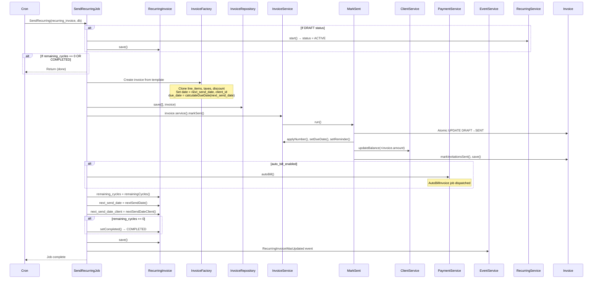

# InvoiceNinja v5.13.50 — Recurring Engine Module FRD

> **Source base:** `E:\invoiceninja-5.13.50`
> **Sources:** `app/Models/RecurringInvoice.php`, `app/Models/RecurringQuote.php`, `app/Models/Subscription.php`, `app/Services/Recurring/RecurringService.php`, `app/Services/Recurring/SendRecurring.php`, `app/Jobs/RecurringInvoice/SendRecurring.php`, `app/Jobs/RecurringInvoice/UpdateRecurring.php`, `app/Services/Recurring/CreateRecurringInvitations.php`, `app/Services/Recurring/IncreasePrice.php`, `app/Services/Recurring/UpdatePrice.php`, `app/Services/Subscription/SubscriptionService.php`, `app/Http/Controllers/RecurringInvoiceController.php`, `app/Http/Controllers/RecurringQuoteController.php`, `app/Http/Controllers/SubscriptionController.php`, `app/Services/Recurring/RecurringService.php`

---

## 1. System Overview & Boundaries

### Scope
**In-scope:**
- Recurring invoice templates: creation, activation, pausing, completion, deletion
- Recurring quote templates: same lifecycle as recurring invoices
- Subscription management: plan creation, client subscription, billing cycles
- Recurring schedule calculation: frequency, due date, next send dates
- Recurring invoice generation: cron-triggered creation of actual invoices from templates
- Auto-pricing: price increases, price updates
- Subscription steps wizard

**Out-of-scope:**
- Individual invoice payment processing (see Invoice/Payment FRDs)
- Payment gateway integration (see Integrations FRD)
- Recurring expense management (separate module)

### Actors
| Actor | Role |
|---|---|
| **Authenticated User** | Creates/recurring templates, manages subscriptions, triggers send-now |
| **Client** | Receives generated invoices/quote; pays via generated invoices |
| **System (Cron)** | Runs `SendRecurring` job to generate and send periodic documents |
| **Payment Gateway** | Receives payment for generated subscription invoices |

### Triggers
| Trigger | Type | Source |
|---|---|---|
| `POST /api/v1/recurring_invoices` | User action | UI/API |
| `POST /api/v1/subscriptions/steps` | User action | Subscription wizard |
| Cron job (`SendRecurring`) | Scheduled | Daily/hourly cron |
| `POST /api/v1/recurring_invoices/bulk` with action `send_now` | User action | Manual trigger |
| `PUT /api/v1/recurring_invoices/{id}` with `start`/`stop` | User action | Activate/pause |

---

## 2. Functional Input/Output Matrix

| Trigger / Action | Input Data | Validation Rules | Expected Output / Side Effects |
|---|---|---|---|
| **Store Recurring Invoice** (`POST /api/v1/recurring_invoices`) | `client_id`, `line_items[]`, `frequency_id`, `next_send_date`, `next_send_date_client`, `due_date_days`, `remaining_cycles`, `auto_bill`, `auto_bill_enabled`, `terms`, `footer`, `discount`, `tax_name1-3`, `tax_rate1-3`, `date` | Client must be valid; `frequency_id` must be valid (1-12); `remaining_cycles` = -1 for infinite | RecurringInvoice created in DRAFT state; calculations applied; `remaining_cycles` validated |
| **Start Recurring Invoice** (`PUT /api/v1/recurring_invoices/{id}`) with `start=true` | None | Must be DRAFT; not deleted; remaining_cycles ≠ 0 | `RecurringService::start()` → status = ACTIVE (or PENDING if next_send_date is future); `next_send_date` set |
| **Stop Recurring Invoice** (`PUT` with `stop=true`) | None | Must be ACTIVE or PENDING | `RecurringService::stop()` → status = PAUSED; if status_id < PAUSED threshold |
| **Send Now** (`PUT` with `send_now=true`) | None | Must be DRAFT or ACTIVE; `invoices()->count() == 0` (first-time only) | `SendRecurring` job dispatched; invoice generated and sent immediately |
| **Update Pricing** (`POST /api/v1/recurring_invoices/bulk` with action `update_prices` or `increase_prices`) | `ids[]`, optional `percentage_increase` | Admin permission required | `UpdateRecurring` job dispatched (async); prices updated across all matching templates |
| **Bulk Status Change** (`POST /api/v1/recurring_invoices/bulk`) | Action enum + IDs | User has edit permission | Batch status update via `performAction()` |
| **Set Payment Link** (`POST /api/v1/recurring_invoices/bulk` with action `set_payment_link`) | `subscription_id` | Valid subscription for the company | Each invoice's `subscription_id` set |
| **Bulk Update** (`POST /api/v1/recurring_invoices/bulk` with action `bulk_update`) | `column`, `new_value`, `ids` | Admin permission for price columns | Column updated across selected templates |
| **Store Subscription** (`POST /api/v1/subscriptions`) | `name`, `amount`, `interval`, `interval_count`, `trial_period`, `trial_interval`, `invoice_id` (link to recurring invoice) | Valid interval; amount ≥ 0 | Subscription created in ACTIVE state; linked to recurring invoice |
| **Subscription Steps** (`GET/POST /api/v1/subscriptions/steps`) | Step data (client selection, plan, billing cycle) | Valid plan; valid client | Multi-step wizard returns available plans and creates subscription |

---

## 3. State Transition Matrix

> **Sources:** `app/Models/RecurringInvoice.php` (§Status Constants, lines 153-161), `app/Models/RecurringInvoice.php` (`getStatusAttribute()`, lines 420-427), `app/Models/RecurringInvoice.php` (`calculateStatus()`, lines 439-452), `app/Services/Recurring/RecurringService.php` (`start()` lines 55-68, `stop()` lines 39-46, `triggeredActions()` lines 113-134, `sendNow()` lines 136-146)

### 3.1 Recurring Invoice Status Transitions

| Current State | Event / Trigger | Condition | New State | Actions Triggered |
|---|---|---|---|---|
| DRAFT | Start | `remaining_cycles ≠ 0` AND `is_deleted = false` | ACTIVE (if next_send_date ≤ today) or PENDING (if next_send_date > today) | `start()` sets status = ACTIVE; `calculateStatus()` determines PENDING at display time |
| DRAFT | Send Now | `invoices().count() == 0` (first-time) | ACTIVE → generates first invoice | `start()` then `SendRecurring` job dispatched; invoice created from template |
| DRAFT | Stop | — | PAUSED | `stop()` if `status_id < STATUS_PAUSED` (i.e., DRAFT or ACTIVE → PAUSED) |
| ACTIVE | Stop | — | PAUSED | `stop()` sets `status_id = PAUSED` |
| ACTIVE | Next cycle reached | Cron fires; `next_send_date` ≤ now | ACTIVE (generates new invoice) | `SendRecurring` job creates invoice; `remaining_cycles` decremented; `next_send_date` advanced |
| ACTIVE | All cycles complete | `remaining_cycles == 0` | COMPLETED | `remainingCycles()` returns 0; `calculateStatus()` sets COMPLETED |
| PAUSED | Start | — | ACTIVE or PENDING | `start()` sets status = ACTIVE; display-time check for PENDING |
| PAUSED | Stop | — | PAUSED (unchanged) | No action (already paused) |
| COMPLETED | remaining_cycles changed to > 0 | Bulk update | PAUSED | Status set to PAUSED; `next_send_date` recalculated from `last_sent_date` |
| COMPLETED | Start | — | ACTIVE | Not directly supported; must un-complete first via remaining_cycles change |
| PENDING (dynamic) | `next_send_date` ≤ today | Display-time check | ACTIVE | `getStatusAttribute()` returns `STATUS_ACTIVE` when `next_send_date` is past; cron generates invoice |
| ANY | Delete (soft) | User action | DELETED (soft) | `is_deleted = true`; `InvoiceRepository::delete()` |

### 3.2 Recurring Invoice Dynamic Status Logic

> **Source:** `app/Models/RecurringInvoice.php`, `getStatusAttribute()` (lines 420-427) and `calculateStatus()` (lines 439-452)

```
getStatusAttribute():
├─ IF status_id == STATUS_ACTIVE AND next_send_date is in future → return STATUS_PENDING
└─ ELSE → return status_id

calculateStatus(new_model):
├─ IF remaining_cycles == 0 → return STATUS_COMPLETED
├─ IF new_model AND status_id == ACTIVE AND next_send_date is future → return STATUS_PENDING
├─ IF remaining_cycles ≠ 0 AND status_id == COMPLETED → return STATUS_ACTIVE
└─ ELSE → return status_id
```

**Key rule:** `STATUS_PENDING` is a **virtual state** — it is never persisted. It is computed at display time when a recurring invoice is ACTIVE but its next scheduled send date hasn't arrived yet. The persisted status remains `STATUS_ACTIVE`.

### 3.3 Subscription Status Transitions

| Current State | Event / Trigger | Condition | New State | Actions Triggered |
|---|---|---|---|---|
| New | Client subscribes | Payment method provided | Active | RecurringInvoice linked; first invoice generated |
| Active | Payment fails | Gateway webhook | Past Due | Reminder emails sent |
| Active | Payment missed | Grace period expires | Unpaid | Client notified; subscription suspended |
| Active | Client cancels | Portal action | Canceled | `auto_bill_enabled = false`; final invoice generated |
| Past Due | Payment received | Gateway webhook | Active | Resumed from grace period |
| Canceled | Client re-subscribes | New subscription | Active | New recurring invoice created |

---

## 4. Business Logic & Rule Extraction

### 4.1 Recurring Schedule Calculation

> **Source:** `app/Models/RecurringInvoice.php` (`nextSendDate()`, lines 454-488; `nextSendDateClient()`, lines 490-533; `nextDateByFrequency()`, lines 535-567; `nextDateByFrequencyNoOffset()`, lines 570-601)

```
nextSendDate() — computes next send in UTC
├─ IF next_send_date_client is null → return null
├─ IF stop_on_unpaid_recurring AND next_send_date < now - 3 days:
│   └─ next_send_date_client = today (reset to prevent back-scheduling)
└─ Switch on frequency_id:
    ├─ DAILY (1):    +1 day
    ├─ WEEKLY (2):   +1 week
    ├─ TWO_WEEKS (3): +2 weeks
    ├─ FOUR_WEEKS (4): +4 weeks
    ├─ MONTHLY (5):  +1 month (NoOverflow)
    ├─ TWO_MONTHS (6): +2 months (NoOverflow)
    ├─ THREE_MONTHS (7): +3 months (NoOverflow)
    ├─ FOUR_MONTHS (8): +4 months (NoOverflow)
    ├─ SIX_MONTHS (9): +6 months (NoOverflow)
    ├─ ANNUALLY (10): +1 year
    ├─ TWO_YEARS (11): +2 years
    ├─ THREE_YEARS (12): +3 years
    └─ default: null

nextSendDateClient() — computes next send in client's timezone
├─ Same switch as above but WITHOUT offset application
├─ Uses client timezone_offset() which may be negative
└─ Returns local date (for display)
```

**Key rule:** `nextSendDate()` (UTC) is stored in the database; `nextSendDateClient()` (local) is computed for display. When `stop_on_unpaid_recurring` is enabled and the schedule is more than 3 days overdue, the date is reset to today to prevent accumulating missed cycles.

### 4.2 Due Date Calculation for Recurring Invoices

> **Source:** `app/Models/RecurringInvoice.php` (`calculateDueDate()` lines 762-782, `calculateDateFromTerms()` lines 790-801)

```
calculateDueDate(date):
├─ due_date_days == 'terms' OR '' OR '0':
│   └─ calculateDateFromTerms(date) → date + client.payment_terms days
├─ due_date_days == 'on_receipt':
│   └─ return Carbon(date) (same day)
└─ default (numeric days):
    └─ setDayOfMonth(date, due_date_days) → date + N days, same day of month
```

**Key rules:**
- If `due_date_days` is empty or "terms", the due date is based on the client's `payment_terms` setting
- If `due_date_days = "on_receipt"`, the invoice is due on the same day it's generated
- Otherwise, a fixed number of days from the send date
- `calculateDateFromTerms` returns `null` if client has no `payment_terms` set (no due date)

### 4.3 Cycle Decrementing

> **Source:** `app/Models/RecurringInvoice.php`, `remainingCycles()` (lines 603-612)

```
remainingCycles():
├─ IF remaining_cycles == 0 → return 0 (completed)
├─ IF remaining_cycles == -1 → return -1 (infinite — never decrements)
└─ ELSE → return remaining_cycles - 1 (decrement by 1 after each generation)

setCompleted():
├─ status_id = STATUS_COMPLETED
├─ next_send_date = null
└─ remaining_cycles = 0
```

**Key rule:** When `remaining_cycles = -1` (infinite), the system never sets `STATUS_COMPLETED`. The `recurringDates()` method generates a preview of the next 10 cycles for display. For finite cycles, each generation decrements by 1, and reaching 0 sets `STATUS_COMPLETED`.

### 4.4 Recurring Invoice Generation (SendRecurring Job)

> **Source:** `app/Jobs/RecurringInvoice/SendRecurring.php`

When the cron fires at the `next_send_date`:

```
SendRecurring(recurring_invoice, company_db)
├─ IF status is DRAFT:
│   └─ start() → status = ACTIVE
├─ IF remaining_cycles == 0 OR status == COMPLETED → return (done)
├─ Create Invoice from RecurringInvoice:
│   ├─ Clone line_items, taxes, discount, terms, footer
│   ├─ Set client_id from recurring invoice
│   ├─ Set date = next_send_date
│   ├─ Set due_date = calculateDueDate(next_send_date)
│   ├─ Apply InvoiceSum calculations
│   └─ Save as DRAFT initially
├─ Invoice->service()->markSent()
│   ├─ Apply number
│   ├─ Set due_date
│   ├─ Update client balance
│   └─ Create invitations
├─ IF auto_bill_enabled on invoice:
│   └─ AutoBillInvoice job dispatched
├─ remaining_cycles decremented (if finite)
├─ next_send_date = nextSendDate() (advanced by frequency)
├─ next_send_date_client = nextSendDateClient()
├─ IF remaining_cycles reaches 0 → setCompleted()
├─ RecurringInvoice updated and saved
└─ RecurringInvoiceWasGenerated event (if applicable)
```

### 4.5 Subscription Integration

> **Source:** `app/Models/Subscription.php`, `app/Models/RecurringInvoice.php` (`setPaymentLink()`), `app/Http/Controllers/SubscriptionStepsController.php`

Subscriptions link to recurring invoices via `subscription_id`:

```
setPaymentLink(subscription_id) — InvoiceService / RecurringService
├─ Decodes subscription_id hash
├─ IF Subscription exists for company:
│   └─ invoice.subscription_id = decoded_id
└─ Save invoice

Subscription model fields:
├─ name: plan name
├─ amount: plan price
├─ interval: day/week/month/year
├─ interval_count: multiplier
├─ trial_period: trial days
├─ trial_interval: trial unit
├─ is_active: boolean
├─ is_free: boolean
├─ is_trial: boolean
├─ invoice_id: link to RecurringInvoice
├─ company_id
└─ user_id
```

**Key rules:**
- A subscription is linked to a recurring invoice template
- The `SubscriptionStepsController` provides a multi-step wizard for client-facing subscription signup
- Trial periods: if `trial_period > 0`, the first invoice is delayed by the trial interval
- Free trials: `is_trial = true` and `is_free = true` for zero-cost subscriptions

### 4.6 Price Updates

> **Source:** `app/Jobs/RecurringInvoice/UpdateRecurring.php`, `app/Services/Recurring/IncreasePrice.php`, `app/Services/Recurring/UpdatePrice.php`

Two price update operations:

**Bulk Price Update** (`UpdateRecurring` job):
- Dispatched async via queue
- Supports actions: `increase_prices`, `update_prices`
- If `increase_prices`: applies `percentage_increase` to all line item costs
- Requires admin permission

**Individual Price Update** (`UpdatePrice` service):
- Called via `RecurringService::updatePrice()`
- Updates recurring invoice pricing from linked subscription

**Increase Price** (`IncreasePrice` service):
- Called via `RecurringService::increasePrice(percentage)`
- Multiplies each line item `cost` by `(1 + percentage/100)`

### 4.7 Auto-Archiving After Generation

> **Source:** `app/Services/Invoice/InvoiceService.php`, `workFlow()` method (lines 657-684)

```
workFlow() — applied to GENERATED invoices, not templates
├─ IF status == PAID AND client.auto_archive_invoice:
│   ├─ IF not trashed → invoice.delete() (soft-delete)
│   └─ Fire InvoiceWasArchived event
├─ IF status == CANCELLED AND client.auto_archive_invoice_cancelled:
│   ├─ IF not trashed → invoice.delete()
│   └─ Fire InvoiceWasArchived event
└─ return $this
```

**Key rule:** Auto-archiving applies to the **generated invoice instance**, not the recurring template. Once a generated invoice is paid (or cancelled), it may be soft-deleted if the client has the setting enabled.

---

## 5. Step-by-Step Functional Workflows

### 5.1 Create and Activate Recurring Invoice (Happy Path)

1. **Pre-conditions:**
   - Authenticated user with `create` permission
   - Valid client belonging to same company
   - At least one line item

2. **Execution Steps:**
   - Step 1: `POST /api/v1/recurring_invoices` with `client_id`, `line_items[]`, `frequency_id`, `next_send_date`, `remaining_cycles`, `due_date_days`
   - Step 2: `RecurringInvoiceFactory::create()` initializes template with company defaults
   - Step 3: `RecurringInvoiceRepository::save()` persists the template in DRAFT state
   - Step 4: `InvoiceSum::build()` calculates `amount`, `total_taxes`, `balance`
   - Step 5: If `counter_number_applied == 'when_saved'`, number is applied
   - Step 6: `RecurringInvoiceService::triggeredActions()` checks for `start=true`:
     - Calls `start()` → sets `status_id = STATUS_ACTIVE`
   - Step 7: `next_send_date` and `next_send_date_client` are stored (client-set and server-computed)
   - Step 8: `RecurringInvoiceWasCreated` event fired
   - Step 9: Template appears in UI as ACTIVE (or PENDING if next_send_date is future)

3. **Post-conditions:**
   - RecurringInvoice saved in ACTIVE status (or DRAFT if not started)
   - `next_send_date` set for first generation
   - `remaining_cycles` decremented to N-1 (if finite)

### 5.2 Recurring Invoice Auto-Generation (Cron Flow)

1. **Pre-conditions:**
   - RecurringInvoice status = ACTIVE (or PENDING that is now ACTIVE)
   - `next_send_date` ≤ current time
   - `remaining_cycles ≠ 0`

2. **Execution Steps:**
   - Step 1: Cron job evaluates all ACTIVE recurring invoices where `next_send_date ≤ now`
   - Step 2: `SendRecurring` job dispatched for each due invoice
   - Step 3: Invoice created from template (clones line items, applies InvoiceSum)
   - Step 4: `InvoiceService::markSent()` transitions generated invoice DRAFT → SENT
   - Step 5: Client balance increased by invoice amount
   - Step 6: Invitations created and email sent (if configured)
   - Step 7: If `auto_bill_enabled`, `AutoBillInvoice` job dispatched for payment processing
   - Step 8: `remaining_cycles` decremented via `remainingCycles()`
   - Step 9: If `remaining_cycles == 0` → `setCompleted()` (status = COMPLETED, next_send_date = null)
   - Step 10: Else → `next_send_date` = `nextSendDate()` (advanced by frequency)
   - Step 11: `RecurringInvoiceUpdated` event fired

3. **Post-conditions:**
   - New Invoice generated and sent to client
   - Recurring template's `next_send_date` advanced
   - `remaining_cycles` decremented (or template completed)
   - Client balance increased

### 5.3 Subscription Creation via Steps Wizard

1. **Pre-conditions:**
   - Client accesses subscription signup page
   - Company has subscriptions configured

2. **Execution Steps:**
   - Step 1: `GET /api/v1/subscriptions/steps` — returns available plans, intervals, trial options
   - Step 2: Client selects plan (amount, interval, interval_count)
   - Step 3: Client provides payment method (or selects "free trial")
   - Step 4: `POST /api/v1/subscriptions/steps/check` — validates client, payment method, plan availability
   - Step 5: `POST /api/v1/subscriptions` — creates Subscription linked to RecurringInvoice template
   - Step 6: If trial period: first invoice delayed; recurring invoice's `next_send_date` set to trial end
   - Step 7: If auto-bill: payment method saved as `ClientGatewayToken`

3. **Post-conditions:**
   - Subscription created in ACTIVE state
   - Linked RecurringInvoice template created
   - First invoice scheduled per trial/billing cycle

---

## 6. Edge Cases & Error Behaviors

| Case ID | Description | Expected Handling |
|---|---|---|
| **RE-001** | Send Now on a recurring invoice that already generated invoices | Guard at line 123: `invoices().count() == 0` — if invoices exist, `sendNow()` returns without action |
| **RE-002** | Stop on a DRAFT or already PAUSED invoice | `stop()` checks `status_id < STATUS_PAUSED` (line 41) — DRAFT (1) < PAUSED (3) → sets to PAUSED; PAUSED (3) < PAUSED (3) is false → no change |
| **RE-003** | Start on a non-DRAFT invoice | `start()` only checks `remaining_cycles ≠ 0 AND is_deleted = false` — status set to ACTIVE regardless of current state (line 65) |
| **RE-004** | Recurring invoice with `remaining_cycles = 0` | `start()` returns `$this` without changing status (line 57); cannot be started |
| **RE-005** | Recurring invoice with negative `next_send_date` (overdue) | `stop_on_unpaid_recurring` resets `next_send_date_client` to today (line 462-465) — prevents back-scheduling accumulated cycles |
| **RE-006** | Frequency that doesn't exist (e.g., 0 or invalid) | `nextSendDate()` returns null for unrecognized frequencies (default case in match) |
| **RE-007** | Client has no `payment_terms` and `due_date_days = 'terms'` | `calculateDateFromTerms()` returns `null` (line 796-797) — invoice has no due date |
| **RE-008** | `remaining_cycles` set to 0 via bulk update | Status set to `STATUS_COMPLETED`; `next_send_date` = null (line 447-449) |
| **RE-009** | `remaining_cycles` changed from 0 to non-zero via bulk update | Status set to `STATUS_PAUSED`; `next_send_date` recalculated from `last_sent_date` if set (line 451-467) |
| **RE-010** | Subscription with trial period | First invoice delayed by trial interval; `is_trial` flag set; client notification includes trial end date |
| **RE-011** | Subscription linked to recurring invoice with `auto_bill = false` | Invoice still generated by cron; client must pay manually via portal |
| **RE-012** | Price increase when `percentage_increase = 0` | No change applied; `UpdateRecurring` job still runs but applies 0% increase |
| **RE-013** | Recurring invoice with `remaining_cycles = -1` (infinite) | `remainingCycles()` returns -1; `calculateStatus()` never sets COMPLETED; runs indefinitely until manually stopped |
| **RE-014** | Time zone shift for client | `scheduledDateTimeUtc()` converts client's local `next_send_date_client` to UTC using client's timezone offset; negative offsets add 86400 seconds (1 day) to compensate for UTC firing time (line 474-475) |
| **RE-015** | Monthly frequency on month-end date (e.g., Jan 31) | `addMonthNoOverflow()` used instead of `addMonth()` — prevents overflow to next month; Feb 28/29 is the target for Jan 31 |
| **RE-016** | Generated invoice is paid and `auto_archive_invoice` enabled | `workFlow()` on the generated invoice soft-deletes it; template continues running independently |

---

## 7. Sequence Diagram — Recurring Invoice Generation (Cron)



---

## 8. API Endpoint Specifications

### 8.1 POST `/api/v1/recurring_invoices` — Create Recurring Invoice

**Request Body:**
```json
{
  "client_id": "hashed_client_id",
  "date": "2024-01-01",
  "next_send_date_client": "2024-01-01",
  "frequency_id": 5,
  "remaining_cycles": -1,
  "due_date_days": "terms",
  "auto_bill_enabled": true,
  "auto_bill": "yes",
  "line_items": [
    {
      "product_key": "SUBSCRIPTION",
      "notes": "Monthly SaaS subscription",
      "cost": 100.00,
      "quantity": 1,
      "unit_name": "month",
      "tax_name1": "VAT",
      "tax_rate1": 20.00
    }
  ],
  "terms": "Net 30",
  "footer": "Thank you"
}
```

### 8.2 POST `/api/v1/subscriptions/steps` — Subscription Wizard

**GET /steps** returns:
```json
{
  "steps": ["client", "plan", "payment_method", "review"],
  "plans": [...],
  "intervals": [...],
  "payment_methods": [...]
}
```

**POST /steps/check** validates:
```json
{
  "client_id": "hashed_client_id",
  "plan_id": "subscription_id",
  "payment_method_id": "token_id"
}
```

---

## 9. Recurring Configuration Reference

### 9.1 Frequency Mapping

| ID | Frequency | Calendar Logic |
|---|---|---|
| 1 | Daily | +1 day from previous |
| 2 | Weekly | +7 days |
| 3 | Two Weeks | +14 days |
| 4 | Four Weeks | +28 days |
| 5 | Monthly | +1 month (NoOverflow) |
| 6 | Two Months | +2 months |
| 7 | Three Months | +3 months |
| 8 | Four Months | +4 months |
| 9 | Six Months | +6 months |
| 10 | Annually | +1 year |
| 11 | Two Years | +2 years |
| 12 | Three Years | +3 years |

**NoOverflow note:** Uses Carbon's `addMonthNoOverflow()` to prevent Jan 31 → Mar 3 cascading. If the target month doesn't have the same day number, it uses the last valid day of that month.

### 9.2 Due Date Days Configuration

| Value | Meaning |
|---|---|
| `'terms'` | Use client's `payment_terms` setting (in days) |
| `''` (empty) | Use client's `payment_terms` setting |
| `'0'` | Due on receipt (same day) |
| `'on_receipt'` | Due on receipt (same day) |
| Numeric (e.g., `30`) | Fixed number of days from send date |

---

## Source Files Referenced

| Source | File |
|---|---|
| RecurringInvoice model | `app/Models/RecurringInvoice.php` |
| RecurringQuote model | `app/Models/RecurringQuote.php` |
| Subscription model | `app/Models/Subscription.php` |
| RecurringService | `app/Services/Recurring/RecurringService.php` |
| SendRecurring job | `app/Jobs/RecurringInvoice/SendRecurring.php` |
| UpdateRecurring job | `app/Jobs/RecurringInvoice/UpdateRecurring.php` |
| RecurringInvoiceController | `app/Http/Controllers/RecurringInvoiceController.php` |
| RecurringQuoteController | `app/Http/Controllers/RecurringQuoteController.php` |
| SubscriptionController | `app/Http/Controllers/SubscriptionController.php` |
| SubscriptionStepsController | `app/Http/Controllers/SubscriptionStepsController.php` |
| SubscriptionService | `app/Services/Subscription/SubscriptionService.php` |
| InvoiceService | `app/Services/Invoice/InvoiceService.php` |
| InvoiceSum | `app/Helpers/Invoice/InvoiceSum.php` |
| PaymentService | `app/Services/Payment/PaymentService.php` |
| ClientService | `app/Services/Client/ClientService.php` |
| HasRecurrence trait | `app/Utils/Traits/Recurring/HasRecurrence.php` |
| API routes | `routes/api.php` |
